# Handrail 상세 아키텍처

> 기준: `1.0.0a6`, 2026-10-08. [아키텍처 요약](architecture.md)을 보완한다. 다이어그램은 코드의 호출·저장·외부 실행 경계를 설명하며, 실서비스 검증 완료를 의미하지 않는다. 새 계약과 제한은 [alpha.6 구현 기록](alpha6-implementation.md)을 함께 읽는다.

> alpha.5 변경: `summary/`가 카드 원본·버전·선택 조회를, `agentroom/cleanup.py`가 완료 후 close/keep 선택을 소유한다. 정식 수락은 보드와 Summary를 동기화한다. 상세 사용법은 [Summary](summaries.md)를 따른다.

> alpha.4 변경: `board/`가 하위 보드 구성·카드 강제 전환·동기화 보류와 재개를 담당한다. 외부 생성 의도는 `board/provisioning.py`로 이동했다. Work 카드의 보드는 명시적 배치 또는 기존 연결을 사용하며 sync에서 하위 보드를 생성하지 않는다. 아래 개발 워크플로우와 별도로 [보드·카드 관리](boards.md)를 제공한다.

## 읽는 순서

1. [시스템 경계와 컴포넌트](#1-시스템-경계와-컴포넌트)
2. [데이터와 상태의 관계](#2-데이터와-상태의-관계)
3. [설정·경로·권한](#3-설정경로권한)
4. [워크플로우 시퀀스](#4-워크플로우-시퀀스)
5. [실패·복구·동시성](#5-실패복구동시성)
6. [코드 탐색과 확장 경계](#6-코드-탐색과-확장-경계)

## 1. 시스템 경계와 컴포넌트

### 1.1 배치와 외부 제품의 관계

Handrail은 명령 실행 시 동작하는 로컬 Python CLI다. 현재 구현에는 상시 실행하는 Handrail 서버나 자체 웹 UI가 없다. 조율자는 CLI를 호출하는 에이전트 또는 사람이며, 작업자는 Herdr가 관리하는 Codex/Cursor 프로세스다.

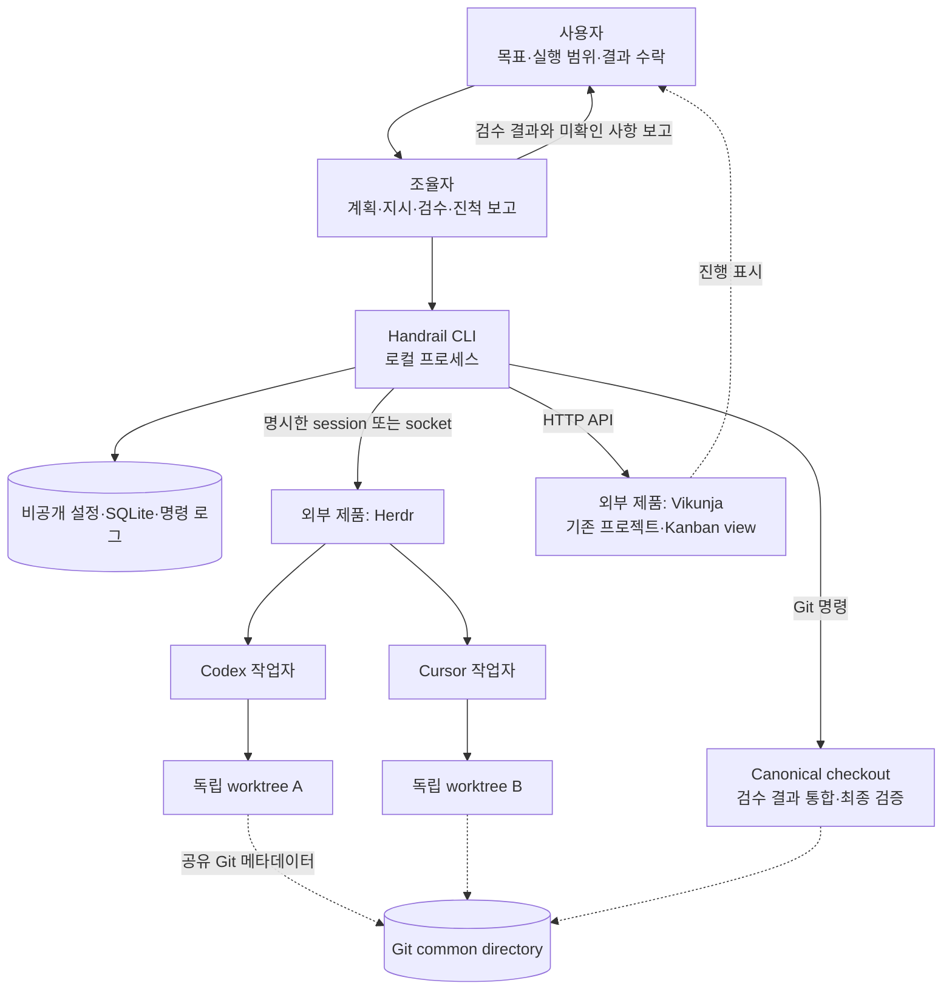

- **Handrail**은 업무 상태, 실행 대상, 승인 기록, 증거와 후처리 의도를 관리한다.
- **Herdr**는 workspace/pane/terminal과 작업자 프로세스에 대한 실행·통신 인터페이스를 제공한다.
- **Vikunja**는 Handrail 이벤트를 카드·관계·버킷·댓글로 표시한다. 보드에서 카드를 옮겼다는 사실만으로 Handrail의 검수나 완료가 성립하지 않는다.
- **Git**은 작업 격리와 통합 revision의 근거다. 작업 디렉터리가 분리되어도 common directory에 대한 쓰기 경계는 공유된다.

### 1.2 논리 컴포넌트와 호출 관계

실선은 호출 또는 저장 접근, 점선은 저장된 이벤트를 통한 후속 처리다. 화살표는 모든 import를 나열한 것이 아니라 주요 실행 의존성을 나타낸다.

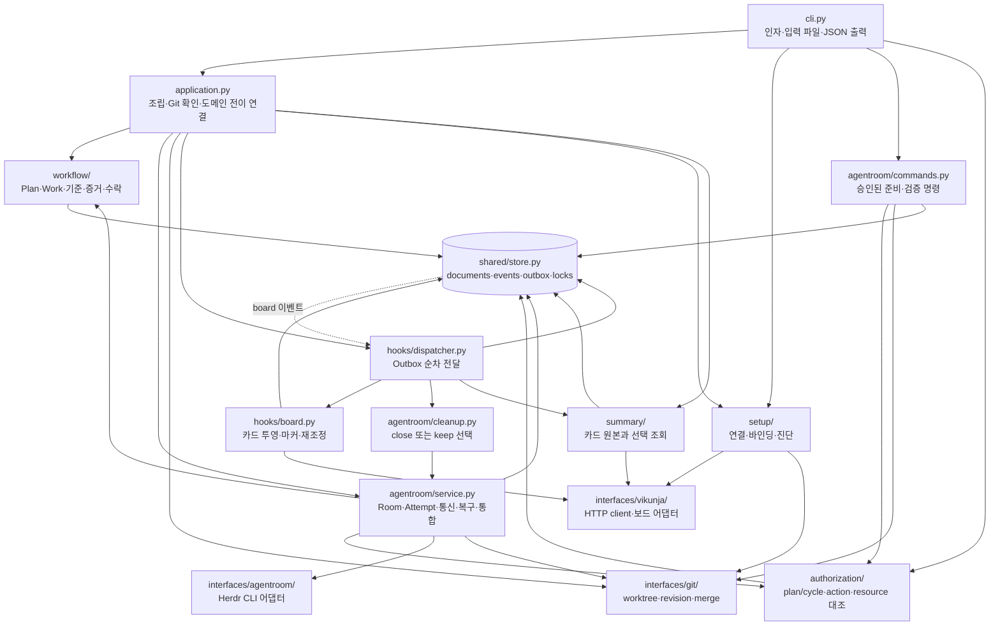

| 컴포넌트 | 책임·소유 정보 | 주요 협력 대상 | 경계 |
| --- | --- | --- | --- |
| CLI | 명령 파싱, JSON·지시 파일 입력, 결과·오류 출력 | Application, Setup, Authorization, Commands | 완료 판단이나 외부 프로토콜 세부 구현을 추가하지 않는다 |
| Application | 서비스 조립, 실제 Git 상태를 확인한 review/evidence/complete/verify/accept | Workflow, Agentroom, Git, Hooks | 코드 상태와 도메인 증거를 연결하는 경계 |
| Setup | 토큰, 연결 프로필, 저장소·보드·endpoint·worktree 설정, 진단 | Git, Vikunja, 로컬 설정 저장 | 기존 외부 서비스에 연결하며 프로젝트 서버를 생성하지 않는다 |
| Workflow | Plan/Work, cycle, 기준별 증거, 승인·검수·검증·제출·수락 | Store | Herdr/Vikunja/subprocess에 의존하지 않는다 |
| Summary | 본문 렌더링·영역 선택·버전·remote 원본, 로컬 hash-only intent와 참조 | Vikunja, Store | 별도 로컬 Summary 원본을 만들지 않는다 |
| Cleanup | 사용자의 room 선택과 고정 범위, 정리 재개 | Summary, Agentroom, Authorization | 기획 수락과 정리 선택을 분리한다 |
| Agentroom | Room, Attempt, 실행 신원, 관찰, 통신 intent, 복구·통합·정리 | Workflow, Authorization, Herdr, Git, Store | 작업자 활동과 업무 완료를 별도로 유지한다 |
| Commands | 정확한 argv/cwd/purpose의 명령 실행, 로그와 종료 결과 | Authorization, Git, Store | 명령 실행 완료 자체가 카드 완료는 아니다 |
| Authorization | 사용자 승인 참조, plan/cycle·행동·자원 범위, 만료·철회 | Store | OS나 에이전트 sandbox 권한을 변경하지 않는다 |
| Hooks | 후처리 순서, 보드 투영 intent, 실패·미확정 전달 기록 | Store, Vikunja, Agentroom | 등록한 Python handler만 실행한다 |
| Interfaces | 각 외부 제품의 호출, 응답 정규화, 오류 분류 | Herdr CLI, Vikunja HTTP, Git 프로세스 | Plan/Work 상태를 직접 결정하지 않는다 |
| Shared | JSON 문서 저장, 추가 전용 이력, Outbox, 잠금, 오류·ID | SQLite, 파일시스템 | 도메인별 승인·완료 규칙을 소유하지 않는다 |

현재 구조는 도메인과 외부 프로토콜을 폴더·서비스로 분리한 형태다. 모든 의존성이 추상 포트를 통해 주입되는 구조는 아니다. Application과 일부 실행 경계에서 구체 어댑터를 생성한다.

## 2. 데이터와 상태의 관계

### 2.1 논리 데이터 모델

아래 관계는 논리 모델이다. 실제 SQLite 테이블은 `documents`, `events`, `outbox`, `meta`이며, Plan·Work 등을 각각 SQL 테이블로 구현하지 않았다. `documents`는 `(kind, id)` 키로 JSON을 저장한다.

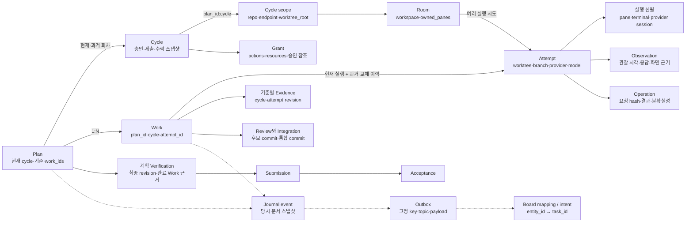

`Cycle`의 과거 도메인 상태는 Plan 문서의 `cycles` 배열에 보존한다. 자원 고정 정보는 별도의 `cycle_scope` 문서다. Review·Evidence·Integration은 Work/Plan 내부 데이터이며, 다이어그램의 모든 상자가 독립 document kind인 것은 아니다.

### 2.2 서로 다른 상태 축

| 상태 축 | 상태 또는 근거 | 변화의 의미 |
| --- | --- | --- |
| Plan 업무 | `todo → doing → review → done` | 실행 시작, 검증된 제출, 사용자 수락 |
| Work 업무 | `todo → doing → review → done` | Review는 조율자 검토 대기; revise/reject는 doing |
| Attempt 생명주기 | `preparing`, `active`, `replaced`, `closed` | 실행 준비·연결·교체·종료 |
| 작업자 활동 | Herdr가 보고한 `working`, `blocked`, `idle`, `done` 등 | 관찰 당시 프로세스 활동; 관찰하지 않은 최신 상태는 알 수 없다 |
| Room | `open`, `closed` | 보존 중인 작업 공간의 생명주기 |
| 외부 operation | `prepared`, `sending`, `complete`, `unknown`, `rejected` | 개별 요청의 적용 여부 |
| Outbox 전달 | `pending`, `sending`, `complete`, `failed`, `unknown` | 이벤트 후처리의 진행 상태 |

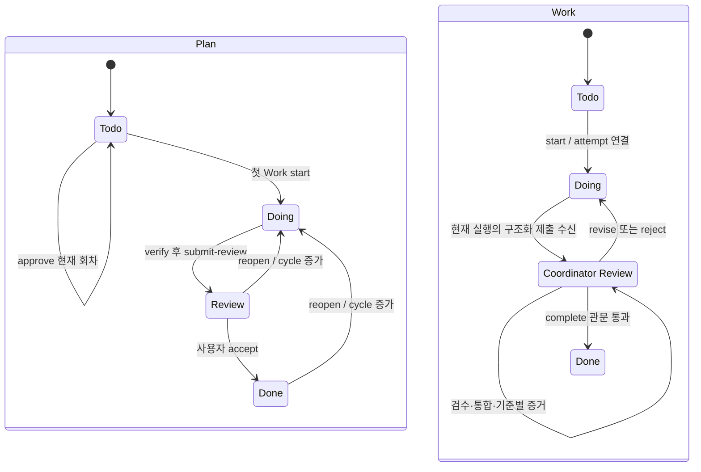

Reopen은 이전 결과를 보존하고 새 회차를 `doing`으로 연다. 새 회차의 approval·verification·submission·acceptance는 비워지므로 실행 전 다시 그 회차의 승인을 기록해야 한다. 이전 회차 Work는 수정하지 않고 새 Work를 생성한다.

### 2.3 완료 근거의 연결

```mermaid
flowchart LR
    S["작업자 clean commit S"] --> R["Review accept<br/>revision S 고정"]
    R --> M["Git integration<br/>후보가 여전히 S인지 확인"]
    M --> I["Canonical commit I"]
    I --> E["Work의 모든 기준<br/>I에 대한 passing evidence"]
    E --> W["Work Done<br/>완료 revision I 보존"]
    W --> F["최종 canonical commit F<br/>모든 완료 I를 포함"]
    F --> P["Plan 기준의 evidence at F"]
    P --> V["Plan verification"]
    V --> S2["Review submission at F"]
    S2 --> A["사용자 acceptance<br/>submission ID와 F 연결"]
```

작업자 커밋 검수, 통합 후 Work 증거, 최종 Plan 증거를 각각 기록한다. Work를 통합한 뒤 그 revision의 증거와 완료를 기록해야 다음 Work를 통합할 수 있다. 이 순서로 후속 merge가 직전 작업의 검증 대상을 바꾸는 것을 막는다.

## 3. 설정·경로·권한

### 3.1 설정과 실행 범위 고정

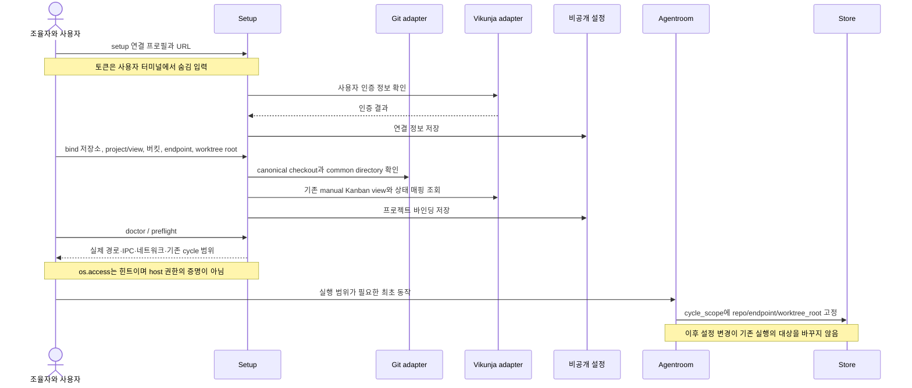

| 저장 위치 | 내용 | 설정 원칙 |
| --- | --- | --- |
| `$XDG_DATA_HOME/handrail/v1` 또는 `~/.local/share/handrail/v1` | 연결·프로젝트 설정, SQLite, 로그 | `HANDRAIL_HOME`으로 변경 가능; 비공개 관리 데이터 |
| 명시한 외부 영속 worktree root | 작업자 소스·브랜치별 작업 디렉터리·의존성 | 대상 프로젝트의 실제 쓰기 허용 범위와 함께 선택 |
| 기본 XDG 기반 `handrail/worktrees/<workspace-id>` | root 미지정 시 작업자 소스 | 홈 아래라는 이유만으로 sandbox 쓰기를 가정하지 않는다 |
| Canonical checkout와 Git common directory | 통합 코드·Git 객체·worktree 메타데이터 | 두 경로를 모두 진단한다 |

저장소 내부 worktree는 명시적 예외 옵션으로 허용한다. `/tmp`는 영속 작업자 저장소로 사용하지 않는다. Room 종료와 worktree 삭제는 별도 수명주기다.

### 3.2 승인 재사용과 실제 접근 권한

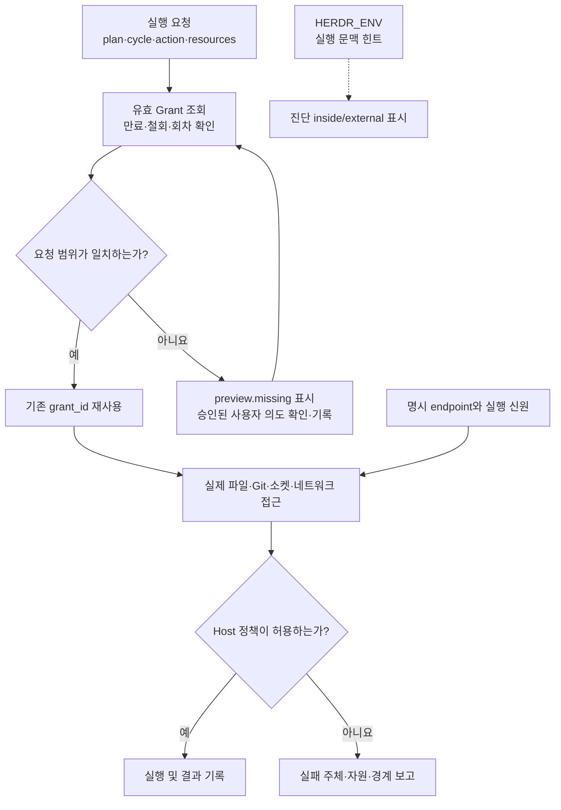

권한 관련 기록은 세 가지다.

1. **Plan approval**: 그 회차의 목표·기준에 대한 구현 승인이다.
2. **Grant**: `room.create`, `worker.start`, `worker.prompt`, `worker.keys`, `worker.recover`, `work.integrate`, `command.run`, `room.close`, `worktree.remove`의 자원 범위다.
3. **Host 권한**: 파일시스템·소켓·네트워크·에이전트 sandbox가 실제로 허용하는 접근이다.

같은 요청 범위에는 기존 grant를 재사용한다. `preview.missing`은 후보 grant에서 일치하지 않는 필드를 보여준다. 현재 구현은 여러 grant를 합성하지 않으며, 요청 자원 필드가 일치하는 하나의 유효 grant를 찾는다. 추가 grant를 기록할 때도 완전한 요청 범위를 구성해야 한다.

`HERDR_ENV=1`을 Handrail이 수동 주입하지 않는다. 상속된 값은 유지하지만 endpoint 선택이나 권한 증명으로 사용하지 않는다. 내부 pane 조율자와 외부 조율자 모두 명시한 연결과 실행 신원을 사용한다.

보드 동기화는 위 action grant 목록에 포함되지 않는다. 현재 구현은 저장된 Vikunja 연결 권한과 명시적인 `sync` 호출로 보드 쓰기를 수행한다. 토큰 권한과 Handrail의 실행 grant를 동일하게 해석하면 안 된다.

## 4. 워크플로우 시퀀스

아래 그림은 명령 하나마다 새 CLI 프로세스가 실행될 수 있는 논리 시퀀스다. `Store`는 각 프로세스가 공유하는 영속 저장소이며, 그림의 참여자가 계속 살아 있는 서비스라는 의미는 아니다.

### 4.1 계획 생성에서 작업자 최초 지시까지

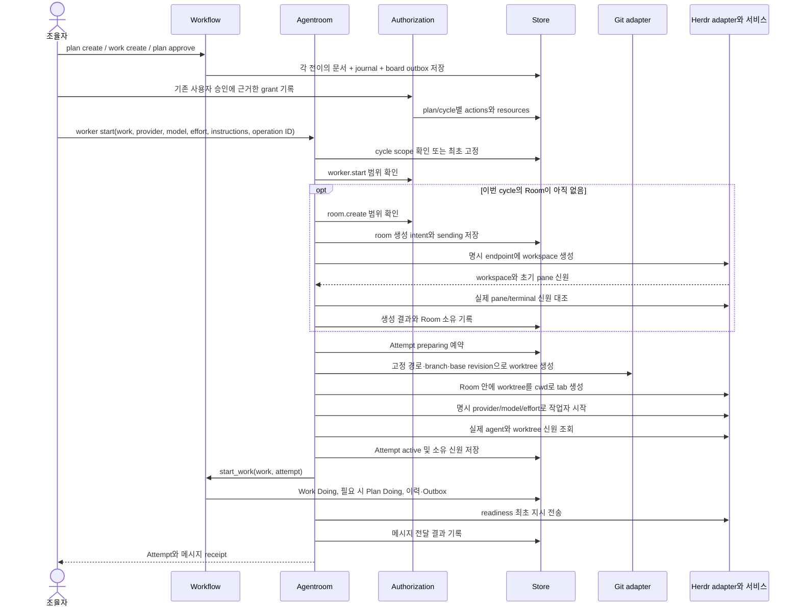

최초 readiness와 준비 완료 뒤의 구현 지시는 `worker.start` 범위에 포함된다. `worker continue`는 작업자 진단 보고를 확인한 뒤 구현을 전달한다. 일반 후속 지시는 `worker.prompt` 범위를 확인한다. Doing은 실행 기록이며 readiness가 실패한 작업을 실제 구현 중이라고 보고하지 않는다. 동일 ID는 기존 Attempt와 원래 요청을 재사용한다. 모델·카드 준비와 완료 인계는 아래 alpha.6 통합 시퀀스를 따른다.

### 4.2 관찰·후속 지시·작업자 교체

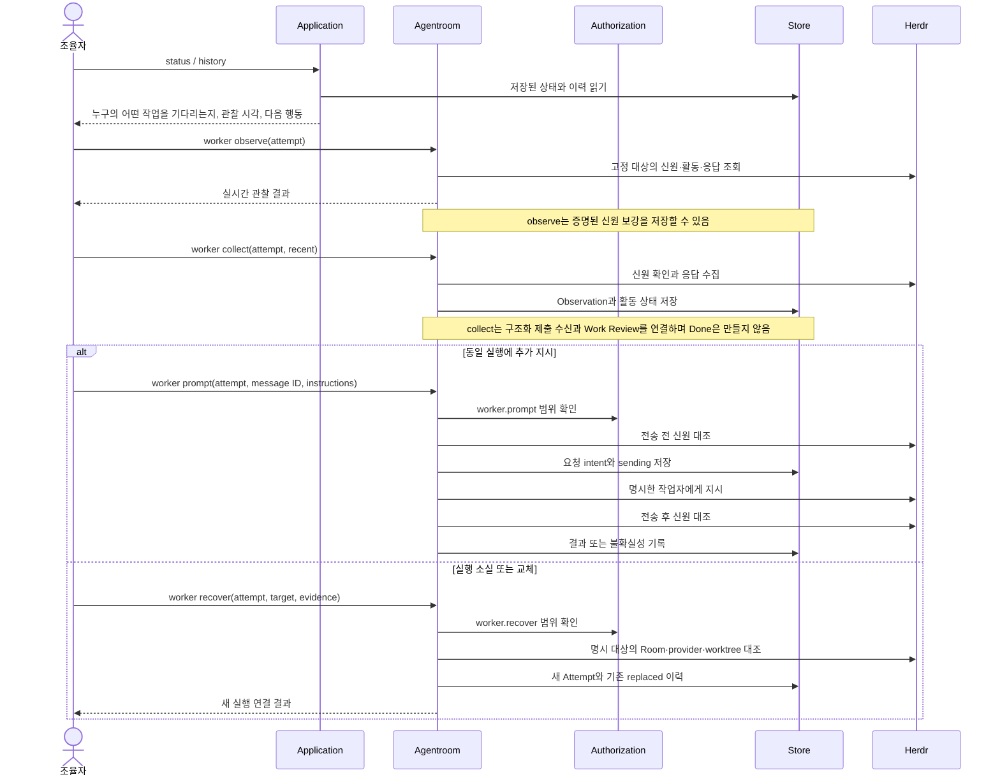

`worker keys`는 이 시퀀스의 일반 지시 전송과 별도다. 저장된 observation·화면 hash·정확한 키 목록·행동 이유를 대조한다. Enter 입력이 추가 권한 승인인지, 단순 지시 전송인지 조율자가 판단해야 한다.

### 4.3 검수·통합·Work 완료

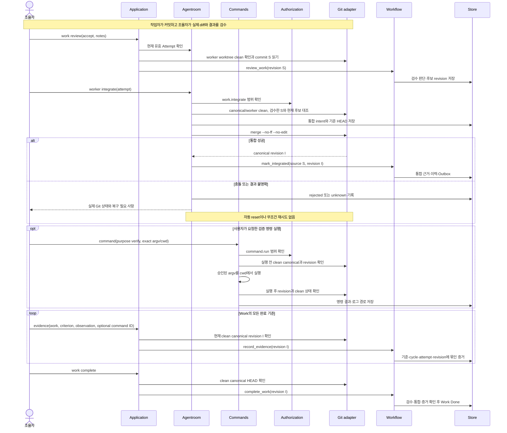

Commands의 실제 함수는 `agentroom/commands.py`의 `run_command`다. 증거에 command ID를 연결하면 같은 plan/cycle·자원 범위의 성공한 canonical 검증인지, 실행 전후 revision과 clean 상태가 일치하는지 확인한다. 텍스트 증거는 조율자가 기록한 관찰 진술이며 자동 검증 실행을 뜻하지 않는다.

### 4.4 계획 검증·사용자 수락·Summary·자원 정리

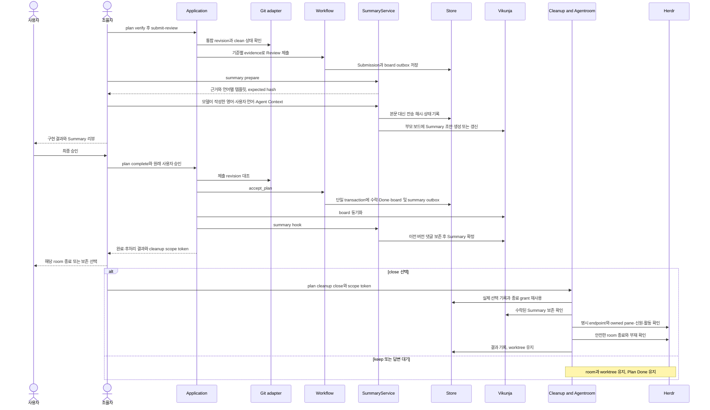

`plan complete`와 `plan accept`는 같은 동작이다. 현재 근거로 작성된 Summary가 없으면 조율자에게 작성 정보를 반환한다. 조율자는 사용자에게 JSON을 요구하거나 수락을 다시 묻지 않고, `summary prepare/publish` 또는 `--summary-file`로 마친 뒤 기존 승인으로 재개한다. CLI 내부에서 별도 모델을 호출하지 않는다.

수락 transaction에 board·summary 후처리가 함께 기록된다. 보드·요약 쓰기가 실패해도 수락은 보존되며 개별 topic sync로 재시도한다. 정리는 cleanup 선택 이후에만 enqueue한다. 이전 버전에서 남은 cleanup outbox도 선택 없이 실행되지 않는다. 이미 종료된 room은 같은 endpoint의 명시적 not-found 근거로만 정리 기록을 조정한다. 다른 room·worktree 삭제로 범위를 넓히지 않는다.

### 4.4.1 후속 기획의 이력 참조

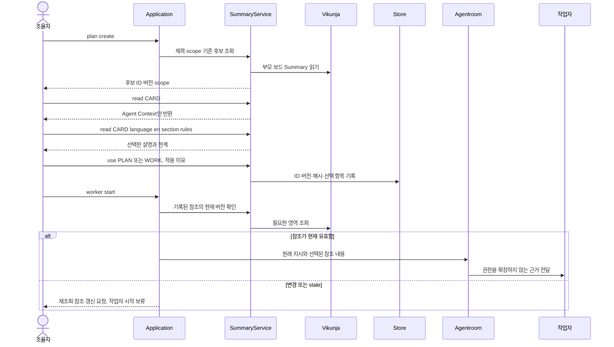

### 4.5 카드·이력의 외부 보드 반영

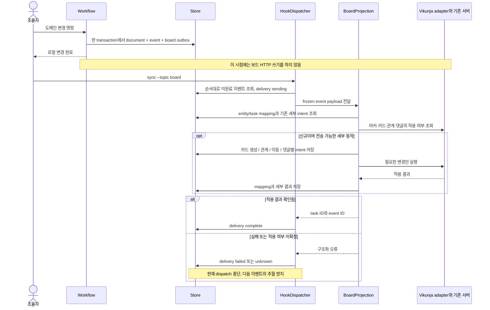

Plan 카드는 부모 보드에 투영된다. Work 카드는 명시적 지정, 보존된 기존 연결, 부모 보드 순으로 결정하며 기존 카드 위치를 유지한다. 하위 보드는 `board add`로 생성한다. 과거 이벤트는 당시 문서 스냅샷을 사용하고 관찰마다 댓글을 쓰지 않는다. 보드 읽기는 중복·충돌 확인에 사용한다. 사용자 지정 카드 상태는 `card_override`로 별도 기록하며, 도메인 검증·통합·수락 상태를 변경하지 않는다. 활성 보류가 있는 카드는 자동 상태 투영을 억제한다.

## 5. 실패·복구·동시성

### 5.1 외부 호출의 트랜잭션 경계

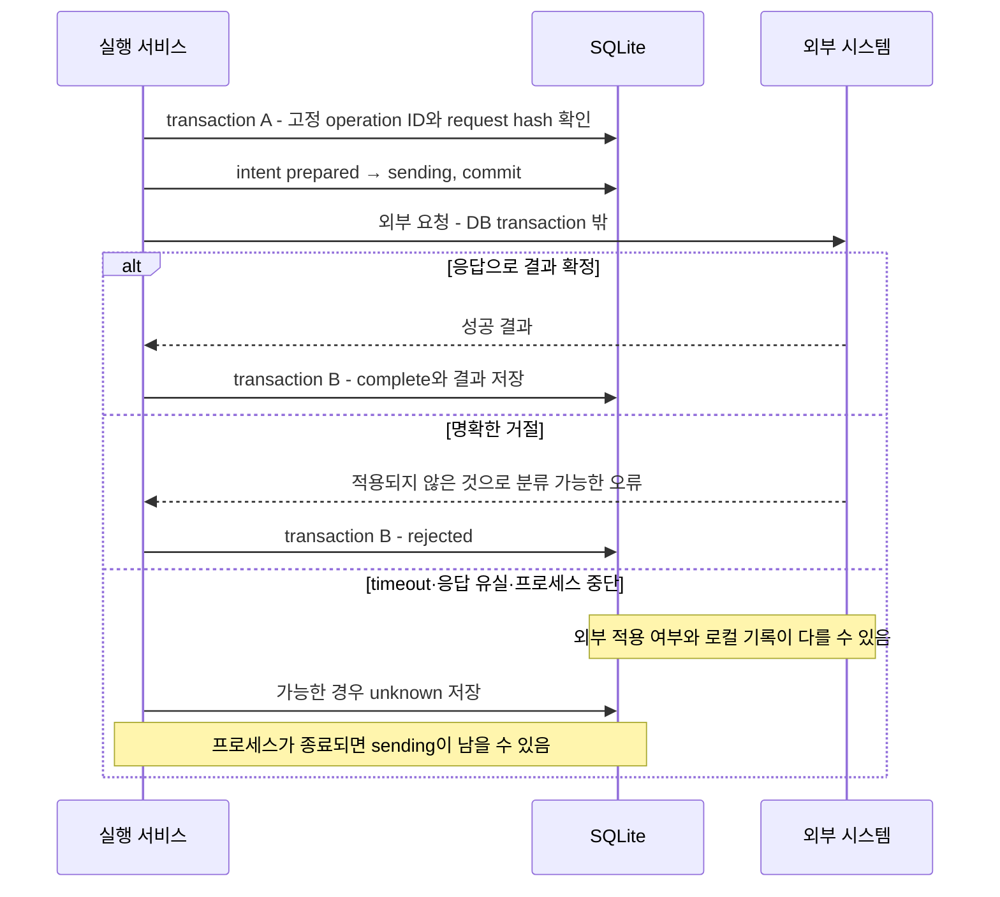

SQLite와 Herdr/Vikunja/Git을 하나의 원자적 transaction으로 묶지 않는다. 재시작 시 `sending`을 미실행으로 가정하지 않고, 관찰·마커·Git revision 등 실제 근거로 조정한다. 로컬 ID와 외부 마커는 중복을 줄이지만 외부 시스템 전체의 정확히 한 번 실행을 보장하지 않는다.

### 5.2 실패별 복구 책임

| 상황 | 유지하는 사실 | 복구 경로 |
| --- | --- | --- |
| 지시 timeout/stall | 전달됐을 가능성, 원래 operation ID | 응답 관찰 후 `worker resolve-message`로 delivered/not_delivered와 근거 기록 |
| Room 생성 응답 유실 | 원래 생성 의도·label·cycle scope | `room adopt`에서 origin operation·workspace·소유 pane을 명시하고 대조 |
| 작업자 교체 | 이전 Attempt와 관찰·검수 이력 | 명시 target에 `worker recover`; 새 Attempt, 이전 것은 replaced |
| Git 충돌·통합 응답 유실 | 검수한 후보와 이전 HEAD, 현재 Git 상태 | 실제 충돌 해결·ancestry 확인 후 integrate 재조정; 자동 reset 없음 |
| 보드 쓰기 미확정 | 이벤트와 카드/관계/이동/댓글 intent | 먼저 외부 조회; 미적용 근거로 `sync --resolve` 기록 후 별도 sync |
| 명령 실행 중단 | argv/cwd·operation·로그·가능한 부수효과 | 실제 프로세스 확인 후 `resolve-command`; 성공 검증으로 바꾸지 않음 |
| 정리 실패 | 사용자 Acceptance와 Plan Done | 소유·활동·승인 확인 후 cleanup 재시도; worktree는 별도 보존 |
| 파일·소켓 권한 실패 | 오류의 주체·자원·host 경계 | 실제 실행 환경의 허용 경로/IPC 확인; HERDR_ENV나 앱 grant로 우회하지 않음 |

`sync --resolve` 자체는 외부 쓰기를 하지 않는다. 재조정 근거를 로컬에 기록하며, 다음 dispatch에서 허용된 재시도가 일어난다. 실패 종류마다 복구 방식이 다르므로 `unknown`을 공통 재시도 버튼처럼 처리하지 않는다.

### 5.3 잠금과 남는 경합

- **`agentroom-mutation`**: worker 실행·통신·복구·통합·정리와 review/evidence/complete/verify/submit/accept의 주요 변경을 직렬화한다.
- **`outbox-delivery`**: 후처리 전달을 직렬화한다. cleanup handler가 Agentroom에 진입하므로 잠금 순서는 `outbox-delivery → agentroom-mutation`이다.
- **SQLite `BEGIN IMMEDIATE`**: 짧은 로컬 변경 transaction 안에서 문서·이력·Outbox를 함께 쓴다. 외부 I/O 동안 DB transaction을 유지하지 않는다.
- 잠금이 이미 다른 조율자에게 있으면 `OPERATION_BUSY`를 반환한다. 백그라운드 작업 큐에서 무한 대기하는 구조가 아니다.

Herdr에는 현재 원자적인 compare-and-send/close가 없다. Handrail의 전후 신원 확인 사이에 다른 주체가 pane을 교체할 수 있는 경합이 남는다. Handrail의 로컬 잠금은 다른 도구가 직접 수행하는 Herdr/Git 조작까지 막지 못한다. protocol generation도 서버 실행 인스턴스의 고유 ID로 사용하지 않는다.

Room 종료에서는 알려진 pane의 소유 신원과 실제 pane 수·소속을 대조한다. 알 수 없는 pane이나 진행 중인 프로세스가 있으면 자원을 보존한다. 작업자가 없는 shell pane도 foreground가 shell임을 확인해야 한다.

## 6. 코드 탐색과 확장 경계

| 확인할 설계 | 구현 진입점 |
| --- | --- |
| CLI와 서비스 조립 | [cli.py](../handrail/cli.py), [application.py](../handrail/application.py) |
| 연결·바인딩·진단 | [settings.py](../handrail/setup/settings.py), [diagnostics.py](../handrail/setup/diagnostics.py) |
| 상태 전이·검수·증거·수락 | [workflow/service.py](../handrail/workflow/service.py), [validation.py](../handrail/workflow/validation.py) |
| 실행·통신·복구·통합·정리 | [agentroom/service.py](../handrail/agentroom/service.py), [identity.py](../handrail/agentroom/identity.py) |
| 준비·검증 명령 | [commands.py](../handrail/agentroom/commands.py) |
| 승인 범위 | [authorization/service.py](../handrail/authorization/service.py) |
| Herdr 어댑터 | [interfaces/agentroom/herdr.py](../handrail/interfaces/agentroom/herdr.py) |
| 기존 Vikunja 연동 | [client.py](../handrail/interfaces/vikunja/client.py), [board.py](../handrail/interfaces/vikunja/board.py) |
| Git 격리·통합 | [repository.py](../handrail/interfaces/git/repository.py) |
| 후처리·보드 투영 | [dispatcher.py](../handrail/hooks/dispatcher.py), [hooks/board.py](../handrail/hooks/board.py) |
| 영속성·오류 | [store.py](../handrail/shared/store.py), [errors.py](../handrail/shared/errors.py) |
| 조율자·작업자 행동 지침 | [스킬](../plugins/handrail/skills/handrail/SKILL.md), [에이전트 통합](agent-integration.md) |

새 외부 제품의 프로토콜은 `interfaces/`에, 새 완료 규칙은 `workflow/`에, 실행 대상·관찰·복구는 `agentroom/`에 추가한다. 이벤트 후처리는 `hooks/`에 등록한다. 신규 기능이 승인·검수·증거 관문을 우회하는 별도 실행 경로를 만들지 않도록 연결 지점을 검토한다.

구체적인 사용 명령은 [운영 안내](manual.md), 이번 포함 범위는 [재구현 범위](rebuild-scope.md), 현재 검증 수준은 [구현 상태](status.md)를 따른다. 이 상세 문서는 향후 backlog나 검증되지 않은 기능을 현재 구현으로 간주하지 않는다.

## alpha.6 준비·인계·지침의 관계

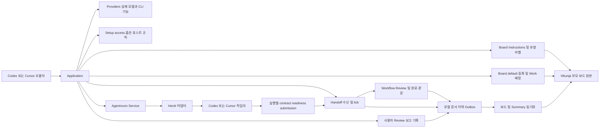

### 준비부터 사용자 Review까지

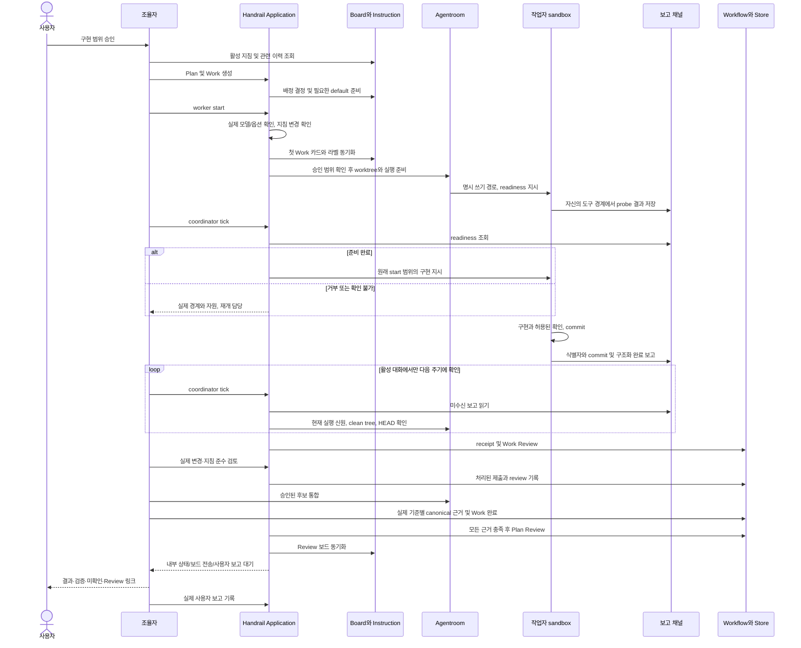

프로세스의 idle/done은 조회 계기다. 제출에 적힌 확인 내용은 조율자의 검토 자료이며 canonical evidence를 대신하지 않는다. monitor는 owner/targets/last_check/next_check/backoff를 저장하고 tick이 끝나면 running=false다. 실제 호스트 wakeup을 등록하지 않았으므로 재접속 시 다시 tick한다.

### 완료 이후 정리 전용 복구

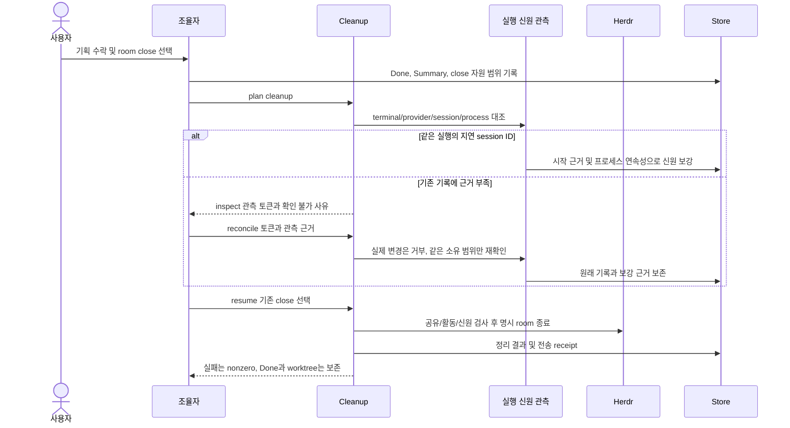

정리 scope token은 workspace, pane, terminal, provider, 등록 이름과 소유 출처를 포함한다. 세션 ID의 정상 보강·관측 시각은 동의 범위를 바꾸지 않는다. 실제 대상 변경, 알 수 없는 pane, 활동 중 worker는 계속 종료를 차단한다. 조회/종료 사이 외부 경합은 남는다.

## alpha.5에서 유지하는 데이터와 복구 경계

| 위치 | 데이터 |
| --- | --- |
| Vikunja Summary 본문 | 분리된 언어 설명, Agent Context, 현재 버전과 기준 근거 |
| 같은 카드 댓글 | 이전 본문 전체와 변경 이유 |
| `summary_card` | 카드 ID, 버전, hash, cycle, record status |
| `summary_reference` | 기획/작업의 참조 ID, 버전, hash, 선택 필드, 적용 이유 |
| `operation` | Summary 외부 쓰기의 요청 해시와 처리 상태; 본문 복제 없음 |
| `cleanup_choice` | 사용자가 선택한 room 집합·scope token·close/keep·승인 출처 |

`summary.write`와 `summary.effect`는 생성·본문·댓글·열 이동의 불명확한 결과를 같은 ID로 조회한다. 원본이 변하면 expected hash가 덮어쓰기를 중단한다. 마지막 GET과 PATCH 사이의 경합을 원자적으로 막지는 못한다. `summary resolve`는 외부 쓰기를 하지 않고 관찰 결과와 재시도 판단을 로컬에 기록한다. 자세한 계약은 [Summary 운영](summaries.md)을 따른다.
