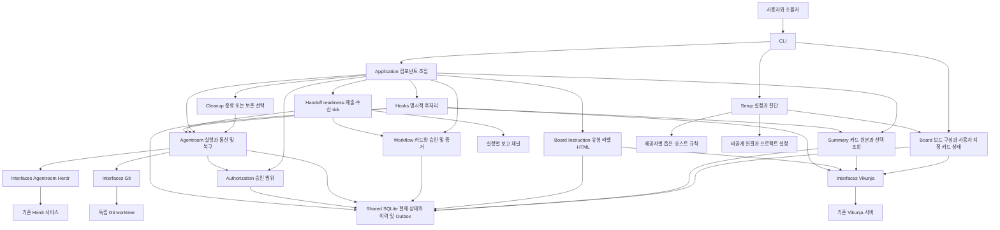
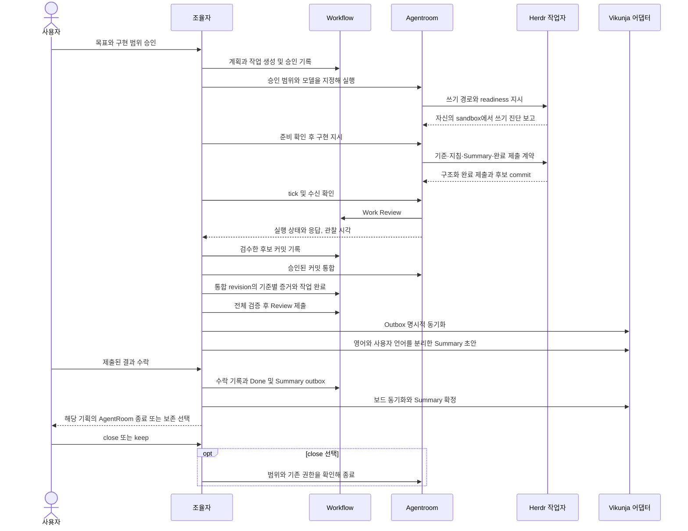

# Handrail 아키텍처

컴포넌트 관계, 데이터 모델, 단계별 시퀀스와 실패 복구 경계는 [상세 아키텍처](architecture-detailed.md)를 참고한다.

alpha.6는 모델·권한 준비, 작업자 readiness와 구조화 완료 인계, 지속 확인, Work Review, 사용자 보고, 부모 보드 Instruction과 유형 라벨을 연결한다. alpha.5의 Summary·수락·정리 계약을 유지하며 Done 이후 신원 복구를 추가했다. 구현·실행 확인의 차이는 [구현 기록](alpha6-implementation.md)을 따른다.

후속 [DEV-11 설계](designs/dev-11-project-automation.md)는 저장소 운영 승인 재사용과 자동 검토·통합·검증·수정·조율자 재개를 제안한다. 아직 구현되지 않았으며 아래의 현재 아키텍처·권한·tick 제약을 대체하지 않는다.

alpha.4부터 보드 구성과 사용자 지정 카드 상태를 `board/` 컴포넌트로 분리한다. `board/provisioning.py`가 보드 준비 의도·복구를 소유하고 `setup/provisioning.py`는 기존 import 호환 경로다. `hooks/routing.py`는 명시적으로 지정된 보드와 기존 카드 위치를 사용한다. 사용 절차는 [저장소 연결](onboarding.md)과 [보드·카드 관리](boards.md)를 따른다.

Handrail은 로컬 워크플로우를 기준으로 개발 진행을 관리한다. 외부 보드의 상태와 작업자 터미널 관찰은 각각의 어댑터를 통해 들어오며, 업무 완료는 승인과 검증 근거를 확인한 워크플로우가 결정한다.

## 컴포넌트 구조도

`workflow`는 Herdr, Vikunja, subprocess를 import하지 않는다. `interfaces`는 도메인 상태 전이나 승인 결정을 수행하지 않는다. `application.py`가 Git 상태 확인, 워크플로우 전이와 외부 어댑터를 연결한다. `agentroom`은 작업자 실행과 관찰을 담당하고 워크플로우의 완료 관문을 호출한다.

설정 프로세스의 쓰기 진단은 `setup/write_access.py`, 호스트 승인 규칙은 `setup/access.py`, 읽기 전용 경로 안내는 `setup/diagnostics.py`가 담당한다. 작업자 자신의 쓰기 관측은 `agentroom/worker_io.py`에 남는다. 빌드는 소스와 번들의 이름 지정 내부 import를 정적 확인하여 모듈 분리 중 함수 참조가 빠진 배포를 차단한다.

## 컴포넌트별 책임

| 컴포넌트 | 소유 데이터와 동작 |
| --- | --- |
| Setup | 연결·바인딩·endpoint·worktree 루트·진단, 고정 런처, 제공자별 승인 규칙과 관측 집계 |
| Board | 하위/default 보드와 첫 카드 배정, 강제 상태/보류, HTML·유형 라벨·Instruction 원본/참조 |
| Workflow | Plan/Work, cycle, 승인, criterion, evidence, review, integration, submission, acceptance |
| Summary | Vikunja Summary의 작성·버전·근거·선택 조회, 로컬 카드 매핑·전송 해시·참조 메타데이터 |
| Agentroom | Room/Attempt/Message/Observation, 모델/실행 신원, readiness 채널, worker_submission, monitor, 복구 |
| Authorization | plan/cycle별 grant, exact resource scope, 승인 출처, 만료와 철회 |
| Interfaces | HTTP/CLI/Git 프로토콜, 응답 정규화, 전송 오류 분류 |
| Hooks | 이벤트의 보드 투영과 승인된 room 정리, 후처리 실패 기록 |
| Shared | 구조화 오류, SQLite transaction, 추가 전용 journal, outbox, 프로세스 간 잠금 |

## 개발 진행 구조도

Plan은 Todo → Doing → Review(사용자) → Done, Work는 Todo → Doing → Review(조율자) → Done을 사용한다. Work revise/reject는 Doing으로 돌아간다. Plan Review 이후 피드백은 새 cycle과 새 Work에 기록한다. 이전 수락과 완료 이력을 덮어쓰지 않는다.

## 영속성과 실패 경계

SQLite 한 transaction에서 현재 문서, journal, outbox를 함께 기록한다. 외부 I/O는 transaction 밖에서 실행한다. 외부 작업은 고정 operation ID에 요청 해시를 묶고 `prepared → sending → complete/unknown/rejected`로 기록한다. 프로세스가 `sending`에서 중단되면 실행되지 않았다고 추정하지 않는다.

`status`, `history`는 로컬 읽기다. `worker observe`는 외부 읽기와 증명된 신원 보강을, `worker collect`는 관찰·완료 수신·보드 동기화를 수행한다. `sync`는 이벤트 투영과 후처리를 재개한다. Work 준비는 default와 배정을 확정하며 새 미배정 Work를 부모 보드에 투영하지 않는다. 일반 관찰마다 보드 댓글을 만들지 않는다.

카드의 사용자 지정 상태는 `card_override`에 기록한다. 개발 작업의 검증·통합·수락 상태를 변경하지 않으며, status에서 두 상태를 함께 보여준다. 관리 작업과 보드 투영은 같은 `outbox-delivery` 잠금을 사용한다. 강제 전환 전후로 쌓인 상태 이벤트는 명시적인 자동 동기화 재개까지 해당 카드를 덮어쓰지 않는다.

현재 상태와 과거 실패는 별도다. 수락 완료와 자원 정리도 별도 상태다. 정리 실패가 사용자 수락을 취소하지 않으며, 미완료 후처리가 상태 출력에 남는다.

## 실행 신원과 HERDR_ENV

연결은 명시적인 `{session: 이름}` 또는 `{socket: 절대경로}`로 고정한다. 내부 pane과 외부 조율자 모두 이 경계를 사용한다. `HERDR_ENV`는 실행 문맥 힌트다. Handrail이 이를 `1`로 만들어 권한이나 연결을 가장하지 않는다.

Attempt는 endpoint, workspace, pane, terminal, 가능한 provider session, Git common directory와 worktree를 연결한다. 전송 전후에 신원을 다시 확인한다. Herdr에 원자적 compare-and-send가 없으므로 조회와 전송 사이 교체 경합은 남는다. protocol generation을 서버 실행 인스턴스 ID로 취급하지 않는다.

alpha.6는 Linux boot ID와 foreground process group 내 실제 제공자 프로세스의 생성 시각·실행 파일·argv 지문으로 연속성을 확인한다. 일시적인 Git·도구 프로세스는 식별 근거에서 제외한다. session ID가 늦게 생기면 원래 시작 근거 및 연속성을 확인한 뒤 Attempt와 소유 기록을 함께 보강한다. 근거가 없으면 확인 불가다. Done cleanup의 inspect/reconcile/resume는 Work·cycle을 다시 시작하지 않는다. 정리 동의의 자원 식별자에는 관측 시각이나 늦게 추가된 세션 정보를 넣지 않는다.

전달 결과, 작업자 활동, 응답 관찰과 업무 검증은 독립적이다. timeout/stall을 미전달로 단정하거나 자동으로 같은 지시를 다시 보내지 않는다. `keys`에는 관찰한 화면과 해당 키 동작의 승인이 필요하다.

## 저장 경로와 권한

관리 상태 기본 경로는 `$XDG_DATA_HOME/handrail/v1`이며 미설정 시 `~/.local/share/handrail/v1`이다. `HANDRAIL_HOME`으로 명시적으로 바꿀 수 있다. 토큰, 프로젝트 설정, SQLite와 명령 로그는 이 비공개 영역에 둔다.

신규 worktree는 명시한 외부 영속 루트를 권장하며, 일반 `init`은 checkout 옆 `.handrail-worktrees/<workspace-id>`를, 고급 `bind`는 XDG 기반 `handrail/worktrees/<workspace-id>`를 사용한다. 실행 기록은 생성 당시의 경로를 유지한다. 저장소 내부는 명시적 예외 설정으로 허용하며 `/tmp`는 영속 worker 저장소로 사용하지 않는다. Room 종료와 worktree 삭제는 별도 동작이다.

앱 내부 grant는 사용자 의도 기록이다. OS/컨테이너 sandbox, 소켓 접근, 네트워크 권한을 부여하지 않는다. 진단은 실제 worktree·canonical checkout·Git common directory·관리 상태·endpoint를 함께 표시한다. 같은 범위는 기존 승인을 재사용하고 변경된 범위만 제시한다.

작업자별 `.channel-<attempt hash>`는 worktree와 같은 부모 아래 별도로 둔다. 작업자는 contract를 읽고 readiness/submission 파일만 제출한다. 조율자 DB와 토큰은 채널에 넣지 않는다. 요청한 경로 권한과 실제 worker probe를 분리하고, 보고를 호스트 인증이나 검증 통과로 해석하지 않는다.

`coordinator tick`은 활성 대화의 단일 확인이며 daemon을 시작하지 않는다. 다음 확인 담당·시각·backoff와 미처리 inbox를 기록한다. 모든 완료 기준이 갖춰지면 followthrough가 Plan Review를 제출하고, `review_notice`는 별도의 사용자 보고 기록을 남긴다. 종료된 대화를 자동 재개한다고 주장하지 않는다.

## 확장 지점

새 외부 제품은 `interfaces/` 어댑터로 추가한다. 훅은 등록된 Python handler만 사용하며 outbox를 소비한다. 임의 shell hook, 승인 자동 생성, 검증 결과 조작을 허용하는 플러그인 경로는 제공하지 않는다. 새 도메인 기능은 해당 컴포넌트에 두고 CLI에는 인자와 출력만 추가한다.

## Summary의 데이터 경계

본문은 부모 보드 카드, 이전 버전은 같은 카드 댓글에 둔다. 로컬은 카드 ID·버전·해시·참조 관계만 관리한다. 조율자가 모델로 내용을 종합하며 CLI는 형식·번역 영역의 존재·기준 fingerprint·전송 상태를 관리한다. `summary read`는 API 전체 응답을 도구 내부에서 파싱하고 필요한 언어·항목만 반환한다. `summary use`의 참조가 바뀌면 작업자 시작 전에 재확인한다. 의미적 번역 품질과 작업자의 의도는 조율자가 원본 근거로 확인한다.

소스의 Summary schema 2는 각 언어에서 프로젝트 결과와 Handrail 수행 이슈를 나누고 Agent Context의 `knowledge.project_results` / `knowledge.handrail_issues`에 대응한다. 이슈 형식·영역 검증은 `summary/format.py`·`issues.py`, 후보 근거 참조·게시·선택 조회는 `summary/service.py`가 담당한다. 수행 관측은 검증 fingerprint·권한·개발 작업을 자동 생성하지 않는다. 기존 schema 1의 읽기·수락·이력을 유지하며 명시적인 작성 없이 과거 본문을 재분류하지 않는다. 설치본 갱신과 실제 보드 수용 확인은 소스 구현과 구분한다.
