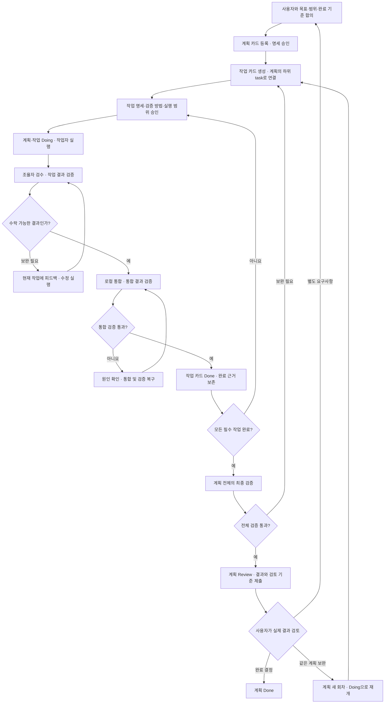

# Handrail의 철학

> Keep human-agent development on track.

Handrail은 사람의 요구사항이 에이전트의 구현을 거쳐 검토 가능한 결과가 되는 과정을 연결한다. 사용자는 무엇을 만들고 언제 완료할지 결정하고, 조율자는 그 결정을 작업·검증·카드 상태에 반영한다. 개발이 이어지는 동안 **어떤 요구에서 시작했고, 무엇이 바뀌었으며, 어떤 근거로 다음 단계에 도달했는지** 확인할 수 있어야 한다.

이 문서는 제품의 의도와 공통 언어를 정의한다. 명령 사용법은 [매뉴얼](manual.md), 개발 소스와 배포본의 차이는 [구현 현황](status.md)을 따른다.

## 우리가 사용하는 문구

| 구분 | 공식 문구 |
| --- | --- |
| Tagline | **Traceable development workflows for humans and coding agents.** |
| Slogan | **Keep human-agent development on track.** |

태그라인은 제품이 제공하는 가치를 설명한다. 사람과 코딩 에이전트가 함께 수행하는 개발 과정에 요구사항, 실행, 변경, 검증, 결정의 연결 기록을 남긴다.

슬로건은 제품의 역할을 표현한다. Handrail이라는 이름처럼, 개발 과정에서 다음 단계와 확인할 기준을 잡을 수 있도록 돕는다. 작업을 위임한 뒤에도 사용자는 진행 상황과 검토할 결과를 찾아갈 수 있다.

공개 소개에서는 태그라인을 짧은 설명으로, 슬로건을 기억할 문장으로 사용한다. 문구 자체는 위 표의 영문 표기를 유지한다.

## 설계 원칙

### 1. 사람의 의도를 실행 가능한 합의로 남긴다

시작점은 사용자가 원하는 결과다. 조율자는 목표, 범위, 제약, 완료 조건과 검증 방법을 명세로 구체화하고 합의를 기록한다. 작업자는 그 범위와 기준을 전달받아 실행한다. 명세가 달라지면 변경된 합의를 확인하고 새 기준에 맞춰 검증한다.

이 과정은 여러 에이전트와 대화 세션을 거쳐도 작업의 목적을 이어가기 위한 것이다.

### 2. 위임한 작업의 결과를 끝까지 확인한다

작업자의 결과 제출 뒤에는 조율자의 책임이 이어진다. 조율자는 실제 변경과 산출물을 검수하고, 필요한 변경을 로컬 저장소에 통합하며, 통합된 결과를 검증한다. 작업 카드는 이 과정이 끝난 뒤 Done이 된다.

모든 필수 작업이 완료되면 계획 전체의 결과를 다시 확인한다. 각 부분의 검사와 전체 결과의 검사를 모두 남겨야 사용자가 검토할 준비가 되었는지 판단할 수 있다.

### 3. 완료의 의미와 다음 담당자를 분명히 한다

작업 카드의 Done은 조율자가 해당 작업을 검수·통합·검증했다는 뜻이다. 계획 카드의 Review는 사용자가 실제 결과를 확인할 차례라는 뜻이다. 계획 카드의 Done은 사용자가 최종 완료를 결정했다는 뜻이다.

이 구분으로 사용자는 개별 작업자의 실행을 계속 지켜보는 부담을 줄이고, 준비된 결과와 필요한 결정에 집중할 수 있다.

### 4. 보완 과정도 이력으로 남긴다

Review 이후의 수정은 항상 새 작업 카드로 남긴다. 기존 Done 카드와 제출 당시의 검증 기록은 보존한다. 어떤 피드백이 들어왔고, 어떤 추가 작업이 이루어졌으며, 다시 무엇을 확인했는지 연결해서 읽을 수 있어야 한다.

같은 목표의 보완은 기존 계획의 새 회차로 진행한다. 목표나 범위가 별도의 요구사항이라면 새 계획 카드로 정리한다.

### 5. 사람의 개입을 존중하며 상태를 맞춘다

카드 상태는 기본적으로 Handrail에 위임한다. 사용자는 필요할 때 보드에서 직접 상태를 바꿀 수 있다. 조율자는 기록과 현재 상태의 차이를 확인하고, 사용자의 의도에 따라 변경을 채택하거나 기존 관리 상태를 다시 적용한다.

상태와 검증 근거는 각각 보존한다. 사람이 Done으로 표시한 사실은 그대로 기록하되, 수행하지 않은 검수·통합·검증을 완료한 것으로 만들지는 않는다.

### 6. 프로젝트의 범위를 명시한다

하나의 Git 저장소는 하나의 Vikunja 부모 프로젝트에서 시작한다. 필요한 하위 보드만 등록하며, 각 보드의 작업 카드는 해당 계획 카드와 실제 하위 task 관계를 가진다.

이 구조는 한 호스트에서 여러 프로젝트를 개발할 때도 각각의 요구사항, 작업, 실행 기록을 구분하게 한다. 작업이 늘어나면 같은 부모 아래에 보드를 추가하면서 관리 범위를 확장할 수 있다.

## 프로젝트와 카드의 구조

다음은 프런트엔드와 백엔드 작업을 나눈 예시다. 작업 카드는 필요에 따라 부모 보드에도 둘 수 있다.

```text
Git 저장소 / Handrail workspace
└── Vikunja 부모 프로젝트
    ├── 계획 카드: 로그인 기능 제공
    ├── 등록된 하위 보드: frontend
    │   └── 작업 카드: 로그인 화면 구현 ──┐
    └── 등록된 하위 보드: backend        │ 계획 카드의
        └── 작업 카드: 로그인 API 구현 ─┘ 실제 하위 task
```

**보드 소속**은 작업을 어디에서 관리하는지 나타낸다. **하위 task 관계**는 어떤 계획을 수행하는 작업인지 나타낸다. 두 정보를 모두 명시한다. 위 예시의 두 작업은 서로 다른 보드에 있지만 같은 로그인 계획에 속한다.

부모 프로젝트는 해당 workspace의 기준점이다. 한 호스트에서 여러 저장소를 관리하면 각 저장소에 별도의 부모 프로젝트를 바인딩한다.

## 전체 workflow

처음에는 기존 Vikunja 연결을 설정하고, 저장소의 부모 보드와 필요한 하위 보드를 등록한다. 이후 각 계획은 아래 흐름을 따른다.



### 실행과 작업 완료

- 작업자는 승인받은 범위를 격리된 worktree에서 수행하고 결과를 제출한다.
- 조율자는 변경 내용과 검증 결과를 확인하고, 수락한 변경을 로컬에 통합한다.
- 통합 후 필수 검증까지 통과한 작업 카드를 Done으로 처리한다.
- 구현 중 수정이 필요한 미완료 작업은 해당 작업의 피드백·수정 절차를 따른다. 이미 Done인 작업의 보완은 새 작업 카드로 만든다.
- 조사·문서 검토처럼 코드 변경이 없는 작업도 승인된 완료 기준과 결과·검수·검증 근거를 남긴다.

현재 기본 실행은 저장소당 순차 실행이다. 여러 하위 보드와 여러 작업자를 사용해도, 활성 쓰기 run은 하나씩 진행한다.

### 계획 Review와 사용자 결정

계획의 필수 작업 전체와 최종 통합 결과를 검증한 뒤 Review로 제출한다. 제출 기록에는 작업 목록, 통합 결과의 식별자, 검증 근거와 사용자 검토 기준을 남긴다. 계획 카드는 이때 `done=false`다.

사용자는 실제 구현을 확인하고 직접 Done으로 바꾸거나 조율자에게 명시적으로 완료 처리를 지시한다. 보완을 요청하면 새 작업 카드를 추가하고 전체 결과를 다시 검증해 다음 Review 회차로 제출한다. 별도 계획을 만드는 경우에는 기존 계획의 Review·Done 이력을 보존하고 두 계획의 관계와 후속 범위를 기록한다.

## 사람이 카드 상태를 바꾼 경우

| 단계 | 하는 일 | 의도 |
| --- | --- | --- |
| 확인 · `preview` | Handrail 기록과 최신 원격 상태의 차이를 보여준다. | 상태를 수정하기 전에 사용자의 의도를 확인한다. |
| 채택 · `adopt` | 사용자가 선택한 원격 상태를 로컬 관리 기록에 반영한다. | 사람의 개입을 새 기준으로 기록한다. |
| 재적용 · `apply` | 사용자가 선택한 기존 관리 상태를 조건에 맞게 원격에 적용한다. | 완료 근거와 실제 상태의 일관성을 회복한다. |
| 재계획 | 필요한 변경을 새 작업 카드로 만든다. | 추가 개발을 추적 가능한 작업으로 이어간다. |

`preview`는 읽기 동작이다. `adopt`는 로컬 기록을, `apply`는 원격 상태를 변경한다. 채택과 재적용에는 사용자의 명시적인 선택을 기록한다. 완료 근거가 필요한 전환은 그 근거도 확인한다.

네트워크 오류로 쓰기 결과가 불분명하면 기존 operation과 원격 상태를 먼저 조회한다. 오래된 실행을 재시도하더라도 사용자가 바꾼 상태를 무조건 덮어쓰지 않는다.

## 용어와 개념

### 사람과 에이전트

| 용어 | 의미와 책임 |
| --- | --- |
| 사용자 · Human | 목표와 범위에 합의하고, 실제 결과를 검토하며 계획의 최종 완료를 결정한다. |
| 조율자 · Orchestrator | 사용자와 합의하고 작업 분해·위임·검수·통합·검증·카드 관리를 책임지는 에이전트다. 현재 기본 조율자는 Codex다. |
| 작업자 · Worker | 위임된 작업을 수행하고 결과를 제출하는 구현 CLI다. 현재 Codex 또는 Cursor CLI를 선택하고 모델을 설정할 수 있다. |
| Handrail | 위 역할 사이의 합의, 실행, 검증, 상태 전환을 연결하고 기록하는 도구다. |

### 프로젝트와 작업 단위

| 용어 | 의미 |
| --- | --- |
| Workspace · Handrail 프로젝트 | Git 저장소, Vikunja 연결, 명세와 작업 이력을 묶는 관리 단위다. |
| 부모 프로젝트 | 한 workspace가 바인딩한 유일한 기준 Vikunja 프로젝트다. 계획 카드를 이곳에 둔다. |
| 하위 보드 · Area | 부모 아래의 하위 프로젝트와 Kanban 뷰를 workspace에 명시적으로 등록한 작업 영역이다. |
| 계획 카드 · Plan card | 사용자의 목표·범위·완료 조건을 담고 필수 작업을 묶는 요구사항 카드다. 사용자 검토의 단위다. |
| 작업 카드 · Work card | 계획을 수행하는 구체적인 구현·조사·문서화 단위다. 계획 카드의 실제 하위 task로 연결한다. |
| 하위 task 관계 | 작업 카드와 계획 카드 사이에 Vikunja로 기록하는 부모·자식 관계다. 서로 다른 프로젝트의 카드도 연결할 수 있다. |
| 명세 · Specification | 합의한 목표, 범위, 제약, 완료 기준과 검증 계획을 Git에 남긴 문서다. |
| 실행 · Run | 특정 작업자의 실행과 결과·검증을 추적하는 기록이다. 카드 한 장에는 실행이나 수정 기록이 이어질 수 있다. |

### 검증과 완료

| 용어 | 의미 |
| --- | --- |
| 검수 · Semantic review | 조율자가 실제 변경과 산출물이 승인된 의도·범위·제약에 맞는지 판단하는 과정이다. |
| 로컬 통합 · Integration | 검수된 작업 결과를 사용자의 로컬 checkout에 반영하는 단계다. |
| 통합 검증 | 통합된 코드와 산출물에서 승인된 자동·수동 검사를 수행하고 근거를 남기는 과정이다. |
| 계획 전체 검증 | 모든 필수 작업이 반영된 최종 결과에서 계획의 완료 기준을 확인하는 과정이다. |
| 검증 근거 · Evidence | 검사 결과, 검수 기록, 명세 및 통합 결과의 식별자처럼 판단을 뒷받침하는 기록이다. |
| Review 회차 · Submission | 계획 개정, 필수 작업 집합, 통합 결과, 검증 근거를 제출 시점에 묶은 이력이다. |
| 외부 변경 · External change | Vikunja UI/API의 상태와 Handrail이 기록한 상태가 달라진 상황이다. |
| 동기화 · Reconciliation | 원격 상태를 재조회하고 사용자의 선택에 따라 기록을 채택하거나 상태를 재적용하는 과정이다. |
| Operation | 카드 생성·댓글·이동 같은 개별 외부 변경의 의도와 결과를 추적하는 기록이다. 응답이 끊긴 경우 복구에 사용한다. |

### 카드 상태를 읽는 법

| 상태 | 계획 카드 | 작업 카드 |
| --- | --- | --- |
| Todo | 실행을 준비하는 요구사항 | 실행을 준비하는 구체적 작업 |
| Doing | 하위 작업 또는 보완 회차가 진행 중 | 실행·검수·통합·검증이 진행 중 |
| Review | 전체 결과를 제출하고 사용자 검토를 기다림 | 기본 workflow에서는 작업별 검수 후 Done으로 진행 |
| Done | 사용자가 최종 완료를 결정함 | 조율자가 검수·통합·검증을 마침 |

작업자의 결과 제출, 조율자의 검수, 계획 카드의 사용자 Review는 각각 다른 시점이다. 완료 보고에는 어떤 카드가 어느 단계에 도달했는지 명시한다.

## 제품의 경계

Handrail은 기존 Vikunja 서비스와 연결하고 로컬 개발 작업을 관리한다. 연결 토큰은 사용자 환경에 보관하며, 조율자는 작업자에게 필요한 범위의 자료를 전달한다. Git 원격 설정, push, PR과 배포는 사용자의 기존 도구 및 조율자가 별도 지시에 따라 수행한다.

현재 개발 트리는 기존 하위 보드 등록을 지원한다. 하위 프로젝트 자동 생성, 병렬 작업자 통합, 추가 조율자 CLI 지원의 개발 범위는 [구현 현황](status.md)과 후속 설계에서 구분한다.

## 이어서 읽기

- [작업 매뉴얼](manual.md): 실제 명령과 실행·복구 절차
- [Worker 실행 권한 정책](worker-authorization-policy.md): 실행 범위와 사용자 승인
- [구조와 저장 위치](architecture.md): 데이터와 실행 환경
- [Workflow 설계 원문](../handrail-dev-spec/v0/PROJECT_WORKFLOW_AND_TERMS.md): 상세 규칙과 인수 기준
- [Workflow 검증 기록](workflow-validation.md): 구현을 확인한 시나리오와 한계
