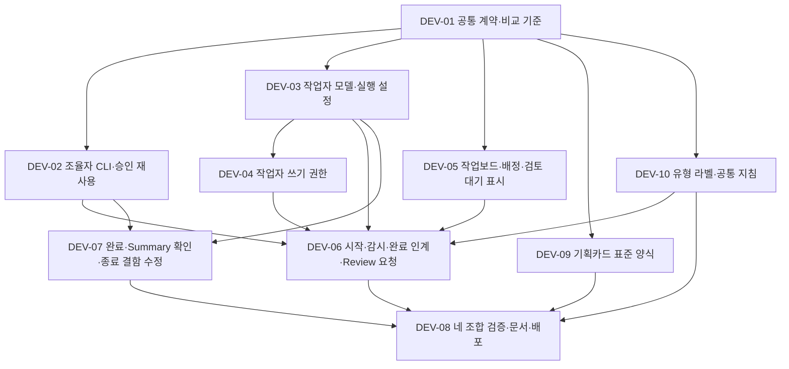

# Handrail 개선 체크리스트 — DEV-11·12 및 기존 종료 기록

기록일: **2026-10-08**. 비교 기준: **1.0.0a5 (alpha.5)**.

**기존 항목 전체 종료: 2026-10-08 / 사용자 요청.** “현재까지의 체크리스트를 모두 닫아줘”에 따라 DEV-01~10과 남아 있던 세부 항목 135개를 종료했다. 당시 기존 확인 완료 7개를 포함한 전체 체크 항목은 142개였으며, 열린 항목은 0개였다. 이 종료 기록은 유지한다.

**현재 열린 개발 단위: DEV-11·12 2개.** DEV-11은 **저장소 단위 최초 승인 재사용과 조율자의 자동 검토·병합·테스트·수정·Review 보고**이며 [설계](designs/dev-11-project-automation.md) 후 구현·호스트 정책 적용·실행 검증 대기다. 후속 요청의 DEV-12는 **Summary 결과/수행 이슈 분리와 개선 근거 축적**으로 소스·스킬 구현과 로컬/번들 검증을 마쳤고 호스트 수용 확인은 대기다. 아래 1~8절은 기존 이력, 9~10절은 현재 작업이다.

**현재 체크 상태: 체크됨 147개 / 열림 22개.** 체크된 항목은 기존 종료 142개와 DEV-12 소스·검증 5개다. 열린 항목은 DEV-11 전체 수용 A01~12 및 RC03 보완 R01~09의 21개, DEV-12 호스트 수용 1개다. 서로 다른 추적 수준을 독립 기능 수나 진행률로 해석하지 않는다. 기존 종료 142개와 DEV-11 21개의 상태는 유지한다.

이번에 닫은 체크박스는 **사용자 요청에 따른 추적 종료**를 뜻한다. 미실행 테스트·미측정 승인 횟수·개별 수용 기준을 통과한 것으로 바꾸지 않는다. 소스 반영, 정적 분석, alpha.6 호스트 설치 및 실제 확인 범위는 기존 근거대로 보존한다. 이후 발견되는 문제는 새 체크리스트 항목으로 등록한다.

**구현 기록:** 현재 소스와 호스트 설치는 **1.0.0a6**다. DEV-01~10의 반영 위치·동작·제약은 [alpha.6 구현 기록](alpha6-implementation.md)에 정리했다. 아래 등록 문단과 ‘현행’은 alpha.5 대비 분석 당시의 이력이며, 미확인 기록은 종료 시점의 근거 한계를 나타낸다.

이 문서는 이번 개발 체크리스트의 종료 이력이다. 사용자 논의와 두 서브에이전트의 코드·문서 검토를 반영하여 기존 CHK 번호 대신 DEV-01~08로 재구성했고, 기획카드 표준 양식과 카드 유형 라벨·공통 지침을 추가하여 **DEV-01~10**을 기록한다. 미등록 제안이었던 CHK-017도 필요한 범위로 편입했다. 과거 전체 backlog를 다시 개발 대상으로 삼지 않는다.

2026-10-08 추가 반영: `handrail_rc_01` 분석과 사용자의 확인에 따라 **작업자 완료 보고 → 조율자 수신 확인 → 검토·통합·검증 → 기획 Review 제출·사용자 보고**를 DEV-06에 편입했다. 완료 알림과 지속적인 상태 확인을 함께 사용하여 인계 누락을 복구한다. DEV-01의 공통 계약, DEV-05의 작업보드 표시, DEV-08의 수용 기준도 함께 갱신했다. 모두 개발 대기 항목이다.

재정리 전 관찰·요구·완료 기록은 [이전 체크리스트](archive/checklist-v1-host-test-before-2026-10-08-reorganization.md)에 보존한다. 현재 구현 수준은 [상태](status.md)를 따른다. 이번 기록 변경은 기능 구현·권한 설정 변경·재설치·테스트 실행 완료를 의미하지 않는다.

2026-10-08 양식 채택: 사용자가 [추천안 #43](http://192.168.0.172:58821/tasks/43)을 기획카드 표준으로 선택했다. **개요 중심 본문 + 언어별 검수 기준 요약표**를 DEV-09로 등록했다. 양식 선택은 완료됐으며 자동 생성·동기화·스킬 반영은 개발 대기다.

2026-10-08 종료 결함 추가: `handrail_rc_01`의 Done 이후 AgentRoom 종료 실패를 반영해 **DEV-07을 기존 기능 수용 확인 + 종료 결함 수정**으로 확장했다. 작업자 식별 정보의 지연 확정·제공자별 누락, 완료 후 정리 전용 복구, 실패 결과·종료 코드와 승인 재사용을 DEV-01·02·03·06·08에 연결했다. 해당 세션의 수동 복구 완료와 Handrail 결함 수정 완료는 별도로 기록한다.

2026-10-08 공통 지침 추가: 사용자 제안과 합의에 따라 **DEV-10 — 카드 유형 라벨·부모 보드 Instruction 관리**를 등록했다. `plan`·`task`·`summary`·`instruction` 라벨을 적용하고, 부모 보드의 공통 지침을 기획·작업 배정·검토에 반영하며 참조 버전을 기록한다. 개발 대기 항목이며 실제 보드·카드 변경은 수행하지 않았다.

## 1. 목표와 등록 당시 상태 해석

1. **같은 유효 범위의 승인과 선택을 재사용하여 사용자 개입을 최소화한다.** 사용자 의도 확인, 보드·모델 선택, 호스트 실행 승인, 최종 수락, 자원 정리 선택을 구분한다.
2. **alpha.5의 기존 기능을 활용한다.** 개선 효과와 함께 새 의존성·복잡도·호환성 비용을 기록하며, 권한 준비 때문에 정상적인 흐름을 불필요하게 늘리지 않는다.
3. **조율자와 작업자는 각각 Codex 또는 Cursor일 수 있다.** 한 제공자에서 확인한 결과를 다른 제공자나 다른 역할의 권한으로 간주하지 않는다.
4. **작업자 완료부터 사용자 Review 요청까지 조율을 이어간다.** 보고 제출·전달·수신·후속 처리 여부를 추적하고, 사용자가 진행 상황을 재질문해야만 완료가 발견되는 흐름을 개선한다.
5. **사용자의 공통 지침을 지속적으로 반영한다.** 부모 보드의 적용 중인 Instruction을 조율자·작업자가 참조하고, 작업별 적용 기준과 변경 이력을 추적한다.

- **개발 대기:** 기존 기능을 활용하더라도 이번 개선분의 구현·수용 확인은 아직 완료되지 않음.
- **기존 구현 / 수용 확인 대기:** alpha.5에 반영되어 있으나 사용자의 최종 확인은 남아 있음.
- **기존 구현 / 결함 수정·수용 확인 대기:** alpha.5 기능을 유지하며 실제 사용에서 확인된 결함을 수정하고 관련 기준을 다시 확인해야 함.
- 이번에 `(사용자 요청으로 종료)`를 붙인 항목은 검증 통과 여부와 별개로 닫았다. 기존 사용자 확인 완료 기록과 실제 확인 근거는 그대로 유지한다.

## 2. 작업 목록과 의존관계

| ID | 개발 단위 | 선행 조건 | 추적 상태 | 종료 시 구현·확인 기록 |
| --- | --- | --- | --- | --- |
| DEV-01 | 공통 실행·승인 계약과 비교 기준 | 없음 | 종료(사용자 요청) | 소스·계약 반영 / 실제 비교 측정 미확인 |
| DEV-02 | 공통 CLI·스킬 연결과 조율자 승인 재사용 | DEV-01 | 종료(사용자 요청) | 소스·스킬 반영 / 호스트 확인 미확인 |
| DEV-03 | 작업자 모델 선택과 제공자 실행 설정 | DEV-01 | 종료(사용자 요청) | 소스 반영 / 제공자 실행 확인 미확인 |
| DEV-04 | 작업자 쓰기 권한 구성·적용 확인 | DEV-01, DEV-03 | 종료(사용자 요청) | 설정·진단 반영 / 실효 쓰기·커밋 확인 미확인 |
| DEV-05 | 작업보드 준비·첫 카드 배정·검토 대기 표시 | DEV-01 | 종료(사용자 요청) | 소스 반영 / 보드 수용 확인 미확인 |
| DEV-06 | 작업 시작·지속 확인·완료 인계·Review 요청 통합 | DEV-02, DEV-03, DEV-04, DEV-05, DEV-10 | 종료(사용자 요청) | 소스·스킬 반영 / 전체 흐름 확인 미확인 |
| DEV-07 | 기획 완료·Summary 수용 확인 및 AgentRoom 종료 결함 수정 | 기존 기능 확인은 독립; 결함 수정은 DEV-01·02·03 | 종료(사용자 요청) | 결함 수정 반영 / 실제 정리 수용 확인 미확인 |
| DEV-08 | 네 조합 검증·문서·배포 및 최종 수용 | DEV-06, DEV-07, DEV-09, DEV-10 | 종료(사용자 요청) | 문서·번들·호스트 설치 완료 / 기능 테스트·수용 미확인 |
| DEV-09 | 기획카드 표준 양식·가독성 개선 | DEV-01 | 종료(사용자 요청) | 양식·선택 조회·스킬 반영 / 표시 확인 미확인 |
| DEV-10 | 카드 유형 라벨·부모 보드 Instruction 관리 | DEV-01 | 종료(사용자 요청) | 소스·스킬 반영 / 실제 API·수용 확인 미확인 |
| DEV-11 | 저장소 단위 최초 승인과 조율자의 자동 검토·병합·테스트 | alpha.6 기존 기능 활용; DEV-01~10 재개 아님 | 열림 — 설계 작성 / 구현 대기 | [신규 설계](designs/dev-11-project-automation.md), 9절 수용 기준 |
| DEV-12 | Summary 프로젝트 결과·Handrail 수행 이슈 분리와 개선 근거 조회 | 기존 Summary·수락·이력 계약 활용 | 열림 — 소스·로컬/번들 검증 완료 / 호스트 수용 대기 | [사용법](summaries.md), 10절 구현·검증 범위 |

**당시 설계한 진행 순서(이력):** DEV-01 이후 DEV-02·03·05·09·10을 병렬로 진행할 수 있다. DEV-04는 DEV-03 완료 직후 시작하며 DEV-02·05·09·10을 기다리지 않는다. DEV-02·04·05·10이 갖춰지면 DEV-06으로 통합하고, DEV-07의 결함 수정·수용 확인과 DEV-09·10의 카드 기능 반영까지 모아 DEV-08을 마무리한다. DEV-06은 공통 계약을 바탕으로 시작 준비 → 완료 제출·수신 기록 → 지속 확인·누락 복구 → 후속 처리·Review 요청 순서로 연결한다. DEV-07의 기존 기능 수용 확인은 독립 진행하고, 종료 결함 수정은 DEV-01·02·03의 식별·승인 계약을 사용한다. DEV-06의 관측 흐름과 종료 복구의 통합 확인은 DEV-08에서 수행한다. DEV-05의 순수 보드 기능, DEV-09의 카드 양식, DEV-10의 라벨·지침 관리는 모델·Herdr 실행 준비를 기다리지 않는다.

## 3. 공통 지원 범위와 책임

| 조율자 | 작업자 | 조율자에 적용할 설정 | 작업자에 적용할 설정 |
| --- | --- | --- | --- |
| Codex | Codex | Codex의 CLI 실행 승인·스킬 연결 | Codex의 sandbox·쓰기 정책 |
| Codex | Cursor | Codex의 CLI 실행 승인·스킬 연결 | Cursor의 sandbox·쓰기 정책 |
| Cursor | Codex | Cursor의 CLI 실행 승인·스킬 연결 | Codex의 sandbox·쓰기 정책 |
| Cursor | Cursor | Cursor의 CLI 실행 승인·스킬 연결 | Cursor의 sandbox·쓰기 정책 |

- **Handrail:** 사용자 의도와 자원 범위 기록, 제공자별 설정 생성, 승인 재사용, 실제 적용 결과 확인을 담당한다. 완료 제출·전달·수신·후속 처리와 감시 상태를 보존하여 조율 재개를 지원한다.
- **Herdr:** 작업 경로와 에이전트 실행 인수를 전달하고 실행 신원·상태를 관찰한다. Handrail의 기획·승인 정책을 Herdr 서버에 구현하지 않는다.
- **Codex·Cursor 및 호스트:** 도구 실행과 파일시스템 접근을 실제로 집행한다. 내부 grant·HERDR_ENV·부모 세션 승인은 작업자의 호스트 권한을 대신하지 않는다.
- 역할·동작·자원·승인 근거·실행 설정·관측 결과는 공통 형식으로 기록하되, 제공자 설정은 지원하는 방식으로 변환한다. 조율자의 규칙을 작업자에게 그대로 복사하지 않는다.
- Cursor 작업자 지원과 Cursor 조율자의 스킬 탐색·CLI 승인 지원을 각각 확인한다. CLI와 IDE의 권한 설정을 혼용하지 않으며, 제공자·버전·호스트 정책을 확인 결과에 남긴다.

## 4. 기존 개발 단위별 체크리스트 — DEV-01~10 종료

### DEV-01 — 공통 실행·승인 계약과 비교 기준

- **현재 추적 상태:** 종료 — 2026-10-08 사용자 요청.
- **담당:** `setup`, `authorization`, `agentroom`, 제공자별 인터페이스.
- **현행:** 기획별 승인·자원 범위·실행 이력, `host_authority: false`와 `worker_authority: not_proven` 구분이 이미 있다. 최신 테스트의 개별 승인 원인과 저장된 허용 규칙은 아직 대조하지 않았다.
- **구현 범위:** 기존 기록을 활용하여 사용자 승인 / 요청 설정 / 실효 권한을 구분하고, 양쪽 역할의 제공자와 필요한 범위를 명세한다. 새 범용 권한 엔진을 만들지 않는다.
- **효과·비용:** 불필요한 재질문과 잘못된 권한 진단을 줄인다. 제공자·호스트별 지원 정보와 적용 이력 관리가 추가된다.

수용 기준:

- [x] (사용자 요청으로 종료) 역할, 제공자·버전, 저장소, 기획·회차·작업·실행, 실제 자원, 동작과 승인 근거를 연결하고 변경된 범위만 식별
- [x] (사용자 요청으로 종료) 기능 지원 여부와 실제 적용 상태를 구분하여 기록; 확인 불가는 `unknown`으로 남기며 준비 완료나 권한 거부로 단정하지 않음
- [x] (사용자 요청으로 종료) 의도 확인·보드 선택·모델 선택·호스트 승인·최종 수락·정리 선택 횟수와 승인 대기 시간을 분리 집계할 기준 마련
- [x] (사용자 요청으로 종료) alpha.5 비교 근거를 확보할 때 실행 주체·거부 자원·규칙·원인을 구분하고, 관측한 요청 수를 실제 사용자 클릭 수로 대체하지 않음
- [x] (사용자 요청으로 종료) 정책 적용·범위 변경·철회·재개를 기록하고, 동일한 거절을 반복 실행하며 승인창을 만들지 않음
- [x] (사용자 요청으로 종료) 네 조합의 지원·미지원·확인 불가와 CLI/IDE 적용 범위를 명시
- [x] (사용자 요청으로 종료) 완료 인계 계약에 Plan·cycle·Work·Attempt·제출 식별자·후보 커밋·검증 결과·미검증·차단 사항을 포함하고, 제출·전달·조율자 수신·처리 완료의 근거를 구분
- [x] (사용자 요청으로 종료) 작업카드 Review는 조율자 검토 대기, 기획카드 Review는 통합·검증 후 사용자 검토 대기로 정의; 작업자 제출·제공자 idle/done을 정식 검증·수락으로 간주하지 않음
- [x] (사용자 요청으로 종료) 제공자별 완료 신호·조율자 알림·대화 종료 후 재개 지원 여부와 감시 담당·주기·지연·중단 상태의 공통 기록 형식을 정함
- [x] (사용자 요청으로 종료) 작업자 식별 정보의 미확정·확정·실제 변경·확인 불가를 구분하고, 실행 연속성의 근거·관측 시각·제공자별 지원 여부를 기록하는 공통 계약 정의
- [x] (사용자 요청으로 종료) 카드 유형과 Instruction의 적용 범위·활성 상태·참조 버전 계약을 정의하고, 공통 설계·구현 지침과 실행 권한 승인을 구분

### DEV-02 — 공통 CLI·스킬 연결과 조율자 승인 재사용

- **현재 추적 상태:** 종료 — 2026-10-08 사용자 요청.
- **선행:** DEV-01.
- **담당:** 설치·설정, CLI, 공통 스킬과 제공자별 지침 연결.
- **현행:** 설치 스크립트가 고정 `handrail` 런처를 만들지만 스킬은 버전별 캐시의 Python 파일을 직접 실행하도록 안내한다. 현재 호스트 런처는 Codex 플러그인 캐시를 가리킨다.
- **구현 범위:** 기존 런처를 검증·재사용하고 호출 형식을 통일한다. Codex·Cursor 조율자가 같은 워크플로우 지침과 활성 런타임을 사용하도록 연결한다. 각 조율자가 사용하는 제공자의 지속 승인 기능을 적용한다.
- **효과·비용:** 업데이트·새 세션에서 명령 경로 차이로 발생하는 재승인을 줄인다. 제공자별 규칙 생성·설정 보존과 호환성 확인은 추가된다. 고정 경로 자체가 호스트 권한을 부여하지는 않는다.

수용 기준:

- [x] (사용자 요청으로 종료) 실행 경로·실제 설치물·스킬 버전을 확인하고, 조율자에 관계없이 동일한 절대 런처와 일관된 인수 순서 사용
- [x] (사용자 요청으로 종료) Cursor 조율자도 공통 스킬을 찾고 활성 버전을 확인할 수 있으며 Codex 캐시 갱신 후에도 유효한 경로 사용
- [x] (사용자 요청으로 종료) 실제 필요한 기능의 최초 승인에서 저장소·기능 범위에 맞는 재사용 규칙을 안내하고, 이미 저장된 규칙은 재사용
- [x] (사용자 요청으로 종료) Codex 접두어와 Cursor 명령·인수 패턴을 별도로 처리; RTK를 포함한 실제 호출 형식의 매칭 범위를 확인
- [x] (사용자 요청으로 종료) `handrail`, `rtk`, Python·셸 전체 허용으로 임의 `command` 실행이나 권한 관리 기능까지 포함하지 않음
- [x] (사용자 요청으로 종료) 기존 사용자 설정·관리 정책을 보존하고, 업데이트가 기존 명령의 권한 범위를 넓히면 이전 승인을 확대 해석하지 않음
- [x] (사용자 요청으로 종료) 승인 규칙 저장을 지원하고 사용자가 선택한 환경에서 동일 범위의 반복 실행·새 세션·호환 업데이트에 추가 승인 없이 진행
- [x] (사용자 요청으로 종료) 순수 로컬 상태·이력 조회의 기존 읽기 전용 경로 유지
- [x] (사용자 요청으로 종료) 승인된 방 정리의 진단·식별 재확인·종료·동기화에 유효한 좁은 호스트 승인 규칙을 재사용하고, 사용자 닫기 동의와 호스트 실행 승인을 구분; 실제 대상 변경 시 필요한 차이만 확인

### DEV-03 — 작업자 모델 선택과 제공자 실행 설정

- **현재 추적 상태:** 종료 — 2026-10-08 사용자 요청.
- **선행:** DEV-01.
- **담당:** `agentroom`, 제공자별 실행 어댑터, 조율자·작업자 스킬.
- **현행:** 제공자·모델을 명시하여 Herdr 작업자를 시작하고, 동일 실행 재개와 중복 방지 기능이 있다. Cursor 어댑터는 별도 `effort` 인자를 현재 거부한다.
- **구현 범위:** 모델 선택을 기본화하고 선택 근거·실제 전달 설정을 기록한다. 기존 Herdr 실행 경로를 재사용한다.
- **효과·비용:** 같은 모델을 반복 선택하는 질문을 줄인다. 모델 식별·옵션 호환성 관리가 추가되지만 alpha.5도 이미 작업자를 사용하므로 기본값 추가 자체가 세션·토큰 증가를 뜻하지 않는다.

수용 기준:

- [x] (사용자 요청으로 종료) 이번 작업의 명시적 사용자 선택 → 유효한 기존 선택 → 확인된 조율자의 제공자·모델·지원되는 추론 설정 순서 적용
- [x] (사용자 요청으로 종료) 모델 미지정 구현 요청은 조율자와 동일한 제공자·정확한 모델의 Herdr 작업자로 수행하며, 교차 제공자는 사용자 선택에 따름
- [x] (사용자 요청으로 종료) 모델·추론 수준을 확인할 수 없거나 지원하지 않으면 필요한 선택만 한 번 요청; 모델명 추정 변환·조용한 설정 저하 금지
- [x] (사용자 요청으로 종료) 실행 인수의 제공자별 유효성을 room·worktree 생성 전에 확인하고, 해석한 값·출처·실제 전달 값을 기록
- [x] (사용자 요청으로 종료) 기존 유효 실행을 재개할 때 기본 모델 정책을 다시 적용해 작업자를 중복 생성하지 않음
- [x] (사용자 요청으로 종료) 작업 지시·완료 기준·제약·작업 위치·관련 Summary의 필요한 영역을 별도 세션에 전달하고 조율자와 구현 작업자를 구분하여 추적
- [x] (사용자 요청으로 종료) 보드 구성·카드 이동 같은 관리 작업은 작업자 실행 없이 조율자가 처리
- [x] (사용자 요청으로 종료) Codex·Cursor 각각 대화 ID 제공 여부·지연 확정·재시작 특성을 확인하고, 대화 ID가 없을 때 사용할 검증 가능한 실행 신원과 한계를 명시; 종료 가능 여부와 미확정 상태를 작업 초기에 진단
- [x] (사용자 요청으로 종료) `null → 관측된 대화 ID`는 실제 교체와 구분하되, 시작 근거·프로세스 연속성 등을 확인한 뒤 Attempt와 room 소유 기록에 함께 반영; 동일 pane·경로·PID만으로 같은 실행임을 확정하지 않음

### DEV-04 — 작업자 쓰기 권한 구성·적용 확인

- **현재 추적 상태:** 종료 — 2026-10-08 사용자 요청.
- **선행:** DEV-01, DEV-03. 통합 절차는 DEV-06에서 연결.
- **담당:** `agentroom`, `setup` 진단, 제공자별 실행 어댑터, `interfaces/git`의 경로·소유 관계 조회.
- **현행:** Codex `workspace-write`, Cursor sandbox enabled를 정적으로 전달한다. 작업자 신원과 작업 경로는 확인하지만 소스·Git 쓰기의 실효 권한은 확인하지 않는다.
- **구현 범위:** 필요한 경로와 제공자별 적용 방식을 계산하고 작업자 자신의 실행 환경에서 적용 결과를 확인한다. 지원되는 실행 설정 또는 제한된 지속 승인 규칙으로 반복 승인을 줄인다.
- **효과·비용:** 구현 후 커밋 단계의 뒤늦은 차단을 줄인다. 시작 진단 시간과 제공자·버전별 대응 비용이 추가된다. 경로 쓰기 성공이 Git 훅·서명 등을 포함한 커밋 성공 전체를 보장하지는 않는다.

수용 기준:

- [x] (사용자 요청으로 종료) 할당된 worktree, 해당 worktree의 실제 Git 관리 디렉터리, 공유 Git 디렉터리를 식별하고 소스 편집·Git 쓰기·통합 권한을 구분
- [x] (사용자 요청으로 종료) Codex의 기존 sandbox 설정과 새 권한 프로필의 충돌·우선순위를 확인하고, Cursor의 CLI 승인 설정과 sandbox 경로 정책을 구분하여 적용
- [x] (사용자 요청으로 종료) 제공자·버전·관리 정책에서 지원하는 방식만 사용하고 사용자 전역 설정을 일괄 변경하지 않음
- [x] (사용자 요청으로 종료) 작업자 자신의 실행 경계에서 정책 관측과 최소 쓰기 진단을 수행하도록 구현; 조율자의 `os.access`나 Herdr 시작 성공으로 대체하지 않음
- [x] (사용자 요청으로 종료) 권한 확인 불가·부족 상태와 필요한 다음 행동을 구현 지시 전에 보고하고, 확인되지 않은 상태를 준비 완료로 표시하지 않음
- [x] (사용자 요청으로 종료) 지원되는 설정이나 저장된 규칙의 동일 유효 범위에서 파일 편집·연속 커밋의 반복 승인이 없어야 함; 첫 실제 커밋의 결과와 실패 원인은 별도 기록
- [x] (사용자 요청으로 종료) 작업자 재시작·교체 시 실효 권한을 재확인하되 승인된 의도·모델·범위는 재질문하지 않음; 새 자원이나 범위 확대는 차이만 안내
- [x] (사용자 요청으로 종료) 작업자에게 조율자 DB·토큰·Herdr 제어 채널·다른 worktree의 쓰기 또는 관리 권한을 함께 부여하지 않음
- [x] (사용자 요청으로 종료) 공유 Git 디렉터리 쓰기는 저장소 차원의 영향이 있음을 명시하고, 자기 브랜치만 변경할 수 있다는 격리 보장으로 표현하지 않음
- [x] (사용자 요청으로 종료) 폴더 추가, trust, `HERDR_ENV`, 내부 grant, 승인 질문 비활성화만으로 Git 쓰기가 해결된다고 안내하지 않음

Git 전용 실행기·broker는 아래 보류 항목으로 관리한다. 단순 진단만 끝내고 반복 승인 감소를 구현 완료로 처리하지 않는다. 지원되지 않는 환경은 제약과 대체 가능한 좁은 승인 경로를 명시한다.

### DEV-05 — 작업보드 준비·첫 카드 배정·검토 대기 표시

- **현재 추적 상태:** 종료 — 2026-10-08 사용자 요청.
- **선행:** DEV-01. 보드 관리 자체는 DEV-03·04와 독립.
- **담당:** `board`, `application`, 카드 배정 훅, 기존 생성·복구 기능.
- **현행:** 하위 보드 생성·등록·배정·복구 기능이 있다. 신규 Work가 배정 없이 먼저 동기화되면 부모 보드에 카드가 생성될 수 있다.
- **구현 범위:** 승인된 구현 요청의 준비 단계에서 작업보드를 결정한다. 작업보드가 없으면 부모 아래 공용 `default`를 준비하고 첫 카드 생성 전에 배정한다. DEV-01의 상태 계약에 따라 작업자 제출 후 조율자 검토 대기를 표시한다. 도메인 전이와 조율 연결은 DEV-06에서 구현한다.
- **효과·비용:** 사용자 수동 준비와 부모 보드의 카드 혼잡을 줄이고 작업 중·검토 대기를 구분한다. 첫 시작이 보드·카드 준비 성공에 의존하며, 기존 보드·중복·장애 처리와 Review 열 호환성 관리가 추가된다.

수용 기준:

- [x] (사용자 요청으로 종료) 초기 설정·기획 작성·일반 조회만으로 생성하지 않고 실제 구현 요청 시 필요한 `default`와 Todo/Doing/Review/Done 열을 준비
- [x] (사용자 요청으로 종료) 부모 보드의 기획·Summary와 작업보드의 Work 역할을 유지하고, 기획별·모델별로 기본 보드를 증식시키지 않음
- [x] (사용자 요청으로 종료) 기존 카드 위치 → Work 배정 → Plan 배정 → 등록된 기본 작업보드 순서로 해석; 작업보드가 없으면 기본 보드 생성·등록
- [x] (사용자 요청으로 종료) 기존 작업보드의 선택이 필요하면 한 번 확인하고 기본 매핑으로 저장; 별도로 만든 동명 보드를 이름만으로 인수하지 않음
- [x] (사용자 요청으로 종료) 서버·부모 보드·실제 보드 ID와 관리 근거로 기본 보드를 식별하며, 같은 부모를 여러 저장소에서 사용할 때 등록된 보드 재사용
- [x] (사용자 요청으로 종료) 신규 Work의 첫 원격 투영 전에 배정을 확정; 미확정 Work는 부모로 임의 투영하지 않고 원래 준비 절차로 재개
- [x] (사용자 요청으로 종료) 기본 보드 변경은 미래 작업에 적용하고 기존 카드 위치·강제 상태·동기화 보류를 보존
- [x] (사용자 요청으로 종료) 같은 호스트의 동시·반복 요청과 부분 성공·응답 유실에 기존 의도·잠금·조회 복구를 적용; 서버 원자성이 없는 여러 호스트의 전역 중복 방지까지 보장하지 않음
- [x] (사용자 요청으로 종료) 생성·선택 실패 시 필요한 조치만 안내하고, 성공한 보드와 이력을 보존하며 기획 완료 때 공용 보드를 삭제하지 않음
- [x] (사용자 요청으로 종료) 기존 작업보드에 Review 열을 준비할 때 기존 승인 범위·매핑·카드 위치·사용자 강제 상태를 보존하며, 부족한 권한이나 모호한 열만 확인
- [x] (사용자 요청으로 종료) 작업카드의 Review에는 조율자 검토 대기라는 의미와 후속 단계·담당을 표시하고, 재작업 전환 및 보드 반영 실패의 재개를 지원

### DEV-06 — 작업 시작·지속 확인·완료 인계·Review 요청 통합

- **현재 추적 상태:** 종료 — 2026-10-08 사용자 요청.
- **선행:** DEV-02·03·04·05·10.
- **담당:** `application`의 조율 흐름, `workflow`의 제출·검토 상태, `agentroom`의 관측·결과 인계, `board`의 투영, 제공자별 연결과 공통 스킬.
- **현행:** `worker collect`는 관찰 기록을 저장하고 조율자는 검토·통합·검증·Review 제출·sync를 각각 실행한다. 작업자 완료를 수집한 뒤 후속 처리가 누락되는 상황을 자동으로 복구하는 연결이 부족하다.
- **구현 범위:** 이미 승인된 의도와 선택을 재사용하며, 시작 준비부터 완료 보고의 전달·수신 확인·후속 처리·사용자 Review 요청까지 이력으로 연결한다. 결과 알림이 누락되면 지속적인 상태 확인으로 발견하고 재개한다.
- **기본 순서:** 사용자 구현 요청과 기존 선택 확인 → 모델·권한 방식 사전 확인 → 보드 준비·Work 배정·카드 등록 → worktree·AgentRoom 준비 → 제공자별 설정으로 작업자 시작 → 작업자 실효 권한 확인 → 구현 지시·감시 → 결과 제출·조율자 수신 확인 → 검토·통합·검증 → 기획 Review 제출·보드 반영·사용자 보고.
- **효과·비용:** 반복 질문과 완료 후 방치를 줄인다. 준비·인계 상태, 재시도·알림 중복 방지, 감시 호출·모델 사용량, 제공자별 재개 지원 확인 비용이 추가된다. 기존 이력·outbox를 활용하고 전체 스케줄러 개편은 실제 필요를 확인해 판단한다.

수용 기준 — 시작 준비:

- [x] (사용자 요청으로 종료) 기획 시작·작업 배정 시 DEV-10의 적용 중인 Instruction을 확인하고, 공통 필수 지침과 작업별 관련 지침·참조 버전을 작업자에게 전달; 작업 중 변경은 영향과 전달 결과를 기록
- [x] (사용자 요청으로 종료) 확인 가능한 기존 값은 재사용하고, 미정 보드·모델 등 독립적인 선택은 가능한 한 묶어서 요청
- [x] (사용자 요청으로 종료) 사용자 의도·호스트 실행 승인·보드 선택을 서로의 답변으로 대신하지 않으며 이미 승인된 기본 준비를 다시 확인하지 않음
- [x] (사용자 요청으로 종료) 보드·카드 준비와 작업자 준비 상태를 기록하고 중단 후 같은 요청·생성 의도·실행 ID로 재개
- [x] (사용자 요청으로 종료) 에이전트 프로세스 실행 성공과 구현 준비 완료를 구분하고, 권한 부족을 실제 작업 진행으로 표시하지 않음
- [x] (사용자 요청으로 종료) 첫 시작은 보드·카드 준비 확인 후 진행; 진행 중인 작업자는 일시적인 보드 동기화 장애만으로 중단·재생성하지 않고 대기 전송으로 복구
- [x] (사용자 요청으로 종료) 재시작·제공자 교체·지시 응답 유실에서 기존 실행과 실제 결과를 먼저 확인하여 중복 지시·작업자 생성 방지
- [x] (사용자 요청으로 종료) 기다리는 대상이 사용자 선택, 호스트 승인, 특정 작업자의 결과 중 무엇인지 구분하여 안내
- [x] (사용자 요청으로 종료) 기존 검토·통합·근거·수락 관문과 Summary 참조를 유지하고, 조율자가 직접 구현하는 별도 실행 체계를 추가하지 않음

수용 기준 — 완료 보고·전달·수신:

- [x] (사용자 요청으로 종료) Codex·Cursor 작업자가 DEV-01의 공통 계약으로 완료 결과를 제출하고, Handrail이 제출 원본·대상 조율자·전달 상태를 보존
- [x] (사용자 요청으로 종료) 프로세스 idle/done·화면 문자열은 수집 계기로 사용하며 제출물의 신원·회차·실행·커밋을 확인; 누락된 보고를 임의로 완성하거나 테스트 통과로 해석하지 않음
- [x] (사용자 요청으로 종료) 조율자 수신 확인과 검토·통합 등 후속 처리 완료를 별도로 기록하고 미수신·미처리 인계를 복구 가능한 작업으로 유지
- [x] (사용자 요청으로 종료) 동일 제출의 재전달·중복 관측은 한 인계로 처리; 이전 회차·교체된 작업자의 늦은 보고는 보존하되 현재 완료 상태를 변경하지 않음
- [x] (사용자 요청으로 종료) 작업자는 할당된 제출 경로만 사용하며 완료 보고를 위해 조율자 DB·보드·권한 설정을 직접 변경할 필요가 없음

수용 기준 — 지속 확인·알림 누락 복구:

- [x] (사용자 요청으로 종료) 시작 시 감시 담당·대상 실행·확인 주기·최근 관측·다음 확인을 기록; 완료 결과·차단·실패·불명 상태를 구분하여 조율자에게 전달
- [x] (사용자 요청으로 종료) 완료 알림 누락 시 상태 확인으로 결과를 수집하고 수신 대기 인계를 재전달; 재접속·재시작 시 미처리 인계와 다음 행동을 복구
- [x] (사용자 요청으로 종료) Codex·Cursor 조율자 각각 대화 종료 후 자동 알림·재개가 가능한지 실제 지원을 확인; 지원되지 않으면 활성 세션의 감시와 재접속 복구를 제공하고 감시 중단·지원 한계를 명시
- [x] (사용자 요청으로 종료) 오래된 관측을 현재 진행 상태로 표시하지 않고 관측 시각·경과 시간·감시 중단·미처리 인계 담당을 함께 안내
- [x] (사용자 요청으로 종료) 관측·수집에서 DEV-03의 검증된 식별 정보 확정 절차를 사용하고 원래 기록·변경 근거를 보존; 대화 ID 누락을 무제한 일치로 취급하거나 관측값으로 기존 신원을 무조건 덮어쓰지 않음
- [x] (사용자 요청으로 종료) 알림·조회·후속 처리에 기존 유효 승인을 재사용하고, 반복 조회마다 승인·보드 댓글·동일 사용자 알림을 만들지 않음; 재시도 간격과 호출·모델 비용을 관리

수용 기준 — 후속 처리·Review 요청:

- [x] (사용자 요청으로 종료) 조율자가 참조한 Instruction 버전을 기준으로 준수 여부·승인된 예외·미확인 사항을 검토 결과에 기록하고, 새 지침과 기존 구현의 충돌은 적용 범위와 시점을 조정
- [x] (사용자 요청으로 종료) 제출을 확인한 작업카드를 조율자 검토 대기로 전환하고, 후보 커밋 변경·재작업 요청 시 이전 제출과 검토를 구분하여 상태를 재개
- [x] (사용자 요청으로 종료) 승인된 구현 범위에서 조율자가 검토·통합·검증을 이어가며, 응답 종료 시 Review 요청 완료·구체적인 차단과 재개 담당·사용자 중단·유효한 감시 인계 중 해당 상태를 남김; 시작 보고만으로 조율 책임을 종료하지 않음
- [x] (사용자 요청으로 종료) 제출 전에 커밋·미추적 파일 등 검토 준비 조건을 확인하고 작업자 계약과 일치시킴; 생성 파일·의존성을 임의 삭제하거나 소유 범위를 확대하지 않음
- [x] (사용자 요청으로 종료) 작업별 검증과 전체 통합 검증의 담당·시점·의존 작업을 구분하고, 과거 기획 단계 설명을 현재 실행 제한으로 복사하지 않도록 지침과 전달 형식을 보완
- [x] (사용자 요청으로 종료) 기획 Review는 필요한 작업의 검토·통합·검증 근거가 갖춰진 후 제출; 작업자 완료 보고만으로 기획 Review 또는 Done을 확정하지 않음
- [x] (사용자 요청으로 종료) 내부 Review 제출·보드 반영·사용자 보고를 각각 추적하고 실패한 단계부터 재개; 내부 상태와 보드 반영 대기를 구분하여 전달
- [x] (사용자 요청으로 종료) 사용자에게 결과 도착·후속 단계와 최종 검토 링크·결과·미검증 사항 또는 실제 차단 사유를 보고; 재시도·재접속 시 중복 보고를 줄임
- [x] (사용자 요청으로 종료) 최종 기획 Done은 사용자 수락으로 유지하고 Summary·AgentRoom 정리는 DEV-07의 절차에 연결

### DEV-07 — 기획 완료·Summary 수용 확인 및 AgentRoom 종료 결함 수정

- **현재 추적 상태:** 종료 — 2026-10-08 사용자 요청.
- **종료 전 구현·확인 기록:** alpha.6 종료 결함 수정 소스 반영 / 호스트·사용자 수용 확인 대기. 기존 완료·Summary·정리 관문은 유지한다.
- **담당:** `workflow`, `summary`, `agentroom/cleanup`·식별 관리, Herdr 어댑터, CLI·후처리 훅, 스킬.
- **선행:** 기존 기능 확인은 독립 진행. 종료 결함 수정은 DEV-01의 식별·상태 계약, DEV-02의 승인 재사용, DEV-03의 제공자별 식별 처리를 사용한다. DEV-06의 관측 흐름과 연결한 확인은 DEV-08에 포함한다.
- **확인된 결함:** 시작 시 저장된 Codex 대화 ID가 `null`이고 종료 때 실제 ID가 관측되면 `ROOM_OCCUPANT_CHANGED`로 차단한다. 작업 중 관측은 이 ID를 갱신하지 않는다. 당시 Cursor 응답에는 대화 ID가 없어 코드상 별도 `ROOM_OCCUPANT_UNPROVEN` 차단 가능성이 있다. 완료 후 `worker recover`는 사용할 수 없으며, `plan cleanup`은 중첩된 정리 실패에도 종료 코드 0을 반환했다.
- **효과·비용:** 조율자의 내부 코드 조사·직접 Herdr 종료와 반복 승인을 줄인다. 제공자별 실행 연속성 확인, 정리 전용 복구·감사 기록과 CLI 결과 호환성 관리가 추가된다. 식별 근거가 불충분한 대상은 보존한다.

수용 기준 — 기존 완료·Summary·정리 경계:

- [x] (사용자 요청으로 종료) 리뷰 최종 승인으로 내부 Plan과 보드가 정식 Done 처리되고 수락 근거가 남음; 강제 카드 이동은 정식 수락 근거를 만들지 않음
- [x] (사용자 요청으로 종료) 조율자가 기존 승인과 근거를 사용해 Summary를 준비하며 사용자에게 재승인이나 수동 JSON 작성을 요구하지 않음
- [x] (사용자 요청으로 종료) 부모 보드의 기획별 단일 Summary에 의도·결과·결정·규칙·회피 사항·고려 사항·검증 한계·출처를 기록하고 원본과 이전 버전은 카드·댓글에 보존
- [x] (사용자 요청으로 종료) 영어·사용자 언어·Agent Context가 분리되고 번역의 중요 제약이 일치하며, 에이전트에는 필요한 언어·항목만 전달
- [x] (사용자 요청으로 종료) Summary 갱신·재시도·외부 편집 충돌을 처리하고, 새 회차에서 stale 표시와 이전 결정의 대체 관계를 보존
- [x] (사용자 요청으로 종료) 다음 기획·작업이 참고한 Summary 카드·버전·범위를 추적하고 낡은 참조를 작업자 지시 전에 재확인
- [x] (사용자 요청으로 종료) 사용자 수락 후 해당 기획의 AgentRoom과 종료 대상을 보여주고 close/keep 선택을 처리; 보존·응답 대기는 기획 Done을 막지 않음
- [x] (사용자 요청으로 종료) 다른 기획·공유·실행 중 자원을 보호하고 실제 종료 결과를 기록; room 정리 동의를 worktree·작업 파일 삭제로 확대하지 않음
- [x] (사용자 요청으로 종료) 수락 후 보드·Summary·정리 후처리 실패가 수락을 취소하지 않고 각각 재개 가능

수용 기준 — 종료 결함 수정·복구:

- [x] (사용자 요청으로 종료) 실행 연속성이 검증된 대화 ID 지연 확정을 정상 처리하고, 실제 다른 대화·프로세스·터미널로의 변경은 별도로 식별하여 종료를 보류
- [x] (사용자 요청으로 종료) 대화 ID를 제공하지 않는 환경은 DEV-03의 검증 가능한 대체 식별 근거를 사용; 확인 불가는 원인과 필요한 다음 행동을 반환하고 무조건 종료하는 우회 경로를 기본화하지 않음
- [x] (사용자 요청으로 종료) Done·통합 완료 후에도 방 정리를 위한 신원 재확인·복구를 제공하며, Work 재개·새 Attempt 생성·수락 취소 없이 승인된 종료 작업만 재개
- [x] (사용자 요청으로 종료) 동일 대상의 식별 정보 보완은 기존 close 선택과 승인 범위를 대조하여 재사용; scope token을 임의로 무시하지 않고 이전 선택과 새 근거를 연결하며, 다른 대상·추가 자원은 변경 범위를 확인
- [x] (사용자 요청으로 종료) 기획 수락 결과와 정리 결과를 분리하여 반환하고 `cleanup` 내부의 failed/unknown도 CLI 종료 코드에 반영; 실패 단계·대상·식별 정보 차이·복구 가능 여부·다음 행동을 명시
- [x] (사용자 요청으로 종료) 진단 → 식별 재확인 → 종료 → 실제 부재 확인 → 이력 반영을 Handrail의 정식 명령·스킬로 연결하고, 조율자가 내부 코드를 조사하거나 직접 Herdr 종료를 수행하는 절차를 일반 복구로 안내하지 않음
- [x] (사용자 요청으로 종료) 기존 선택·outbox·operation을 재사용하여 중단·응답 유실·동기화 실패에서 중복 종료 없이 복구; 외부에서 이미 닫힌 방도 명시적 부재 근거로 결과를 대조하고 정리 이력에 기록
- [x] (사용자 요청으로 종료) 공유·활성·교체·확인 불가 자원 보호와 worktree·소스 보존을 유지하고, 이미 성공한 정리 단계와 수락·Summary 이력을 재시도로 훼손하지 않음

### DEV-08 — 네 조합 검증·문서·배포 및 최종 수용

- **현재 추적 상태:** 종료 — 2026-10-08 사용자 요청.
- **선행:** DEV-06, DEV-07, DEV-09, DEV-10. 검증 시나리오·문서 준비는 앞 단계와 함께 진행할 수 있다.
- **담당:** 설치·문서·스킬, 통합 검증과 사용자 수용 기록.
- **상태 구분:** alpha.5 설치 이력을 유지하고 alpha.6 소스·스킬·문서·번들을 작성했다. 구문 정적 분석과 번들 생성 후 2026-10-08 별도 사용자 요청에 따른 호스트 재설치를 완료했다. 네 조합 실행·사용자 수용 확인은 미실행이다. 이 체크리스트 등록은 테스트 실행 지시가 아니다.

수용 기준:

- [x] (사용자 요청으로 종료) 네 가지 조율자–작업자 조합별로 스킬 탐색·런타임 일치·모델 선택·보드 준비·쓰기·커밋·재개·완료 흐름의 결과와 제한 기록
- [x] (사용자 요청으로 종료) 아래 반복 승인 시나리오에서 alpha.5 기준과 개선 후 결과를 같은 조건으로 비교하고, 확인되지 않은 조합을 성공 처리하지 않음
- [x] (사용자 요청으로 종료) 완료된 기존 기능과 DEV-07의 수락·Summary·정리 경계를 새 조율 흐름에서 유지
- [x] (사용자 요청으로 종료) Codex 대화 ID 지연 확정, Cursor 대화 ID 미제공, 실제 대화 교체·프로세스 재시작, Done 이후 정리 복구, 외부 종료·응답 유실·중첩 실패 종료 코드를 확인; 직접 Herdr 조작 없이 성공하거나 근거 있는 차단과 재개 방법을 반환
- [x] (사용자 요청으로 종료) 같은 방 정리의 재시도에서 close 동의·호스트 요청·실제 승인 횟수를 구분하여 비교하고, 식별 정보 보완만으로 불필요한 재승인이 생기지 않는지 확인
- [x] (사용자 요청으로 종료) DEV-09 양식으로 생성·갱신된 기획카드의 실제 보드 표시, 언어 분리, 상세와 요약표의 일치 및 기존 카드 보존을 확인
- [x] (사용자 요청으로 종료) DEV-10의 네 유형 라벨·사용자 직접 작성 지침·조율자 생성·중단 복구를 확인하고, Codex·Cursor 네 조합에서 기획·배정·검토의 지침 전달 및 실제 참조 버전이 연결되는지 확인
- [x] (사용자 요청으로 종료) 지침 수정·대체·폐기·충돌·조회 실패·중복 유형 라벨에서 사용자 편집과 과거 적용 이력을 보존하고, 지침을 실행 승인으로 확대 해석하지 않는지 확인
- [x] (사용자 요청으로 종료) 네 조합에서 사용자의 진행 상황 재질문 없이 작업자 제출 → 조율자 수신 → 후속 처리 → Review 요청 또는 차단 보고까지 연결되는지 확인하고 호스트별 지원 한계를 기록
- [x] (사용자 요청으로 종료) 완료 알림 유실·중복·늦은 보고·작업자 교체·조율자 재시작·감시 중단·보드 장애에서 인계 누락과 중복 후속 처리 없이 재개되는지 확인
- [x] (사용자 요청으로 종료) 작업자 제출·조율자 수신·검토 시작·Review 제출·사용자 보고 시각을 분리 측정하고, 감지 지연·미처리 대기·조회량·모델 비용·추가 승인 수를 alpha.5와 비교
- [x] (사용자 요청으로 종료) 사용자 설정·연결·토큰·보드 배정·실행 이력·기존 worktree를 보존하는 업그레이드 및 중단 복구 확인
- [x] (사용자 요청으로 종료) 운영·설치·아키텍처·철학·조율자/작업자 스킬을 실제 개발 버전으로 최신화하고 지원·미지원·미확인 범위를 구분
- [x] (사용자 요청으로 종료) Codex·Cursor 조율자 모두 설치 후 활성 실행기와 스킬을 확인할 수 있고, 사용자가 다시 테스트할 수 있는 설치 결과 제공
- [x] (사용자 요청으로 종료) 구현 완료·정적 확인·호스트 실행 확인·사용자 최종 수용을 각각 근거로 기록한 뒤 해당 기준 종료

### DEV-09 — 기획카드 표준 양식·가독성 개선

- **현재 추적 상태:** 종료 — 2026-10-08 사용자 요청.
- **종료 전 구현·확인 기록:** 추천안 #43의 생성 양식·선택 조회·스킬 반영 / 실제 카드 표시 확인 대기.
- **선행:** DEV-01의 식별자·상태 계약. DEV-02·03·05와 병렬 구현 가능.
- **담당:** `workflow`의 기획 내용 구성, `board`의 카드 투영, `interfaces/vikunja`의 서식 전달, 공통 조율자·작업자 스킬.
- **채택 근거:** 원본 [#37](http://192.168.0.172:58821/tasks/37)의 문단·섹션 구분 문제를 세 시안으로 비교한 뒤, A의 개요 중심 본문에 C의 간결한 검수 요약표를 결합한 [추천안 #43](http://192.168.0.172:58821/tasks/43)을 사용자가 선택했다.
- **구현 범위:** 기획카드 작성·갱신에 동일한 양식을 적용하고 에이전트가 필요한 언어·섹션을 참조하도록 안내한다. Vikunja 서버·UI 변경은 포함하지 않는다.
- **효과·비용:** 목적·범위·검수 기준을 빠르게 파악할 수 있다. 번역과 요약표로 본문 길이가 늘며 상세·번역·표 사이의 일관성 관리가 필요하다.

수용 기준:

- [x] (사용자 요청으로 종료) 개요(목적·대상·기술 구성) → 범위·기능별 상세 요구사항 → 검증 방법·근거 → 검수 기준 요약표 순서로 구성하며, 없는 내용을 임의로 채우지 않음
- [x] (사용자 요청으로 종료) 영어를 먼저 작성하고 사용자의 언어가 영어가 아니면 번역을 별도 최상위 영역에 작성; 문단마다 두 언어를 섞지 않으며 각 언어 영역 끝에 해당 언어의 요약표 배치
- [x] (사용자 요청으로 종료) 제목·문단·목록·강조·구분선·표가 실제 서식으로 표시되도록 HTML을 전달하고 입력 텍스트를 적절히 이스케이프; 줄바꿈이나 Markdown 문법만으로 서식을 기대하지 않음
- [x] (사용자 요청으로 종료) 요약표는 `ID / 확인할 결과`의 간결한 두 열을 사용; 상세와 동일한 기준에서 만들고 기획별 실제 기준 수를 반영하며 샘플의 16개로 고정하지 않음
- [x] (사용자 요청으로 종료) 기준 ID·수치·제약·검증 방법·출처를 상세와 번역에 보존하고, 요약표의 기대 결과를 검증 통과 표시로 오인하게 작성하지 않음
- [x] (사용자 요청으로 종료) Codex·Cursor 공통 스킬에 작성 양식과 필요한 언어·섹션만 읽는 규칙을 반영; 필요한 상세 제약을 요약표만으로 대체하지 않음
- [x] (사용자 요청으로 종료) 새 기획카드에 기본 적용하고 동기화·재시도에도 서식과 식별자를 유지; 기존 카드의 편집·상태·이력·동기화 보류를 보존하며 일괄 변환은 별도 명시 범위로 처리
- [x] (사용자 요청으로 종료) 채택한 기본 양식 사용을 매번 재승인받지 않음; 샘플 #43의 Done은 시안 작성 완료이며 일반 기획카드의 상태·검토·사용자 수락 관문은 유지
- [x] (사용자 요청으로 종료) 실제 보드의 긴 본문·좁은 화면에서 제목·문단·표의 가독성을 확인하고 운영 문서·스킬을 개발 버전 기준으로 갱신

### DEV-10 — 카드 유형 라벨·부모 보드 Instruction 관리

- **현재 추적 상태:** 종료 — 2026-10-08 사용자 요청.
- **종료 전 구현·확인 기록:** 유형 라벨·지침 관리·참조 이력 소스 및 스킬 반영 / 실제 API·사용자 수용 확인 대기.
- **선행:** DEV-01의 카드 유형·적용 범위·참조 버전 계약. DEV-09와 언어 분리·서식 원칙을 공유하고 DEV-06에서 작업 흐름에 연결한다.
- **담당:** `board`의 유형 라벨·지침 카드 관리, `workflow`의 지침 적용·참조 기록, `agentroom`의 작업 지시 전달, `interfaces/vikunja`의 라벨·카드·이력 연동, 공통 스킬.
- **구현 범위:** 사용자 또는 조율자가 부모 보드에 공통 지침을 작성·관리하고, 조율자가 기획·배정·검토 시 참조하며 작업자에게 준수를 요구한다. 원본은 Vikunja 카드에 두고 별도의 지침 원본 파일을 중복 관리하지 않는다.
- **효과·비용:** 사용자 의도를 반복 설명하는 부담을 줄이고 작업 간 기준을 유지한다. 라벨 중복·외부 편집·버전·충돌 관리와 조회·컨텍스트 비용이 추가되므로 필요한 시점의 변경 확인과 관련 영역 전달을 사용한다.

유형과 기본 위치:

| 라벨 | 역할 | 기본 위치 |
| --- | --- | --- |
| `plan` | 목표·범위·완료 기준을 가진 기획카드 | 부모 보드 |
| `task` | 작업자에게 배정한 작업카드; 내부 Work에 대응 | 작업보드 |
| `summary` | 완료 결과·결정·후속 참고사항 | 부모 보드 |
| `instruction` | 이후 기획·구현·검토에 지속 적용할 공통 지침 | 부모 보드 |

수용 기준 — 라벨·작성·관리:

- [x] (사용자 요청으로 종료) Handrail이 생성·관리하는 카드에 유형 라벨을 자동 부여·유지하고, 카드당 유형 라벨 하나와 추가 주제 라벨을 함께 지원; 유형 충돌은 진단하며 다른 사용자 라벨을 삭제하지 않음
- [x] (사용자 요청으로 종료) 기존 라벨·실제 ID를 확인하여 재사용하고 생성·부착의 부분 실패·응답 유실을 기존 의도·조회로 복구; 같은 요청으로 라벨·카드를 중복 생성하지 않음
- [x] (사용자 요청으로 종료) 기존 관리 카드의 유형은 기록된 연결로 판별하여 적용하고 카드 위치·상태·본문·이력을 보존; 제목만으로 임의 카드를 인수하거나 라벨 변경으로 workflow 완료를 만들지 않음
- [x] (사용자 요청으로 종료) 사용자가 연결된 부모 보드에 직접 만든 `instruction` 카드도 발견·참조하며 내부 JSON이나 별도 등록 명령을 필수로 요구하지 않음; 모호한 유형·적용 범위만 확인
- [x] (사용자 요청으로 종료) 명확한 사용자 등록·수정 요청은 조율자가 기존 승인 범위에서 처리하고 동일 요청의 재승인을 요구하지 않음; 지침 관리 자체를 위해 Plan·Work·AgentRoom을 생성하지 않음
- [x] (사용자 요청으로 종료) 주제별 지침에 목적·적용 범위·준수 사항·예외와 고려사항·검토 기준을 담고 영어·사용자 언어는 별도 영역으로 작성; 사용자가 직접 쓴 본문은 보존하며 누락 항목을 임의로 작성해 덮어쓰지 않음
- [x] (사용자 요청으로 종료) Instruction은 적용 중·대체됨·폐기됨으로 관리하고 기획 Done 이후에도 유효성을 유지; 사용자 직접 작성 카드에 명시적 비활성 표시가 없으면 적용 대상으로 읽고 모호한 충돌만 확인
- [x] (사용자 요청으로 종료) 원본과 변경 이유·조회하여 사용한 이전 버전은 카드와 보드 이력에 연결하여 보존; 로컬에는 참조·동기화 정보와 재생성 가능한 캐시만 두며 독립적인 지침 원본으로 운영하지 않음

수용 기준 — 기획·배정·검토·변경:

- [x] (사용자 요청으로 종료) 조율자는 연결된 부모 보드의 적용 중인 지침을 기획 시작·작업 배정·검토 시 확인하고 적용 범위를 판단; 공통 필수 지침과 작업별 관련 세부를 Codex·Cursor 작업자에게 전달
- [x] (사용자 요청으로 종료) Plan·Work와 작업 지시에 실제 참조한 카드 ID·버전 또는 내용 해시·관련 영역·적용 범위를 기록하여 이후 수정에도 당시 기준을 추적
- [x] (사용자 요청으로 종료) 진행 중 지침 변경은 영향이 있는 작업을 식별해 전달하고 적용 시점·예외·재작업 필요성을 기록; 과거 검토 기준을 새 본문으로 조용히 바꾸지 않음
- [x] (사용자 요청으로 종료) 현재 사용자의 구체적인 요청·여러 지침 간 충돌은 적용 범위를 조정해 이유를 기록하고 의도가 불명확할 때만 확인; 지침 본문을 모델 변경·권한 확대·자원 삭제의 승인으로 사용하지 않음
- [x] (사용자 요청으로 종료) 조율자는 결과의 준수 여부·예외·검토 근거·미확인 사항을 기록하고 작업자의 준수 주장만으로 검증 완료 처리하지 않음
- [x] (사용자 요청으로 종료) Summary는 과거 결과·결정, Instruction은 지속 적용 기준으로 구분; Summary에서 공통 지침 후보를 제안할 수 있으나 사용자 요청 없이 자동 승격하지 않음
- [x] (사용자 요청으로 종료) 반복 전체 읽기를 줄이되 필수 제약을 생략하지 않고 필요한 언어·영역만 전달; 조회 실패·오래된 캐시는 시점과 한계를 표시하며 지침이 없는 것으로 처리하지 않음

## 5. 승인 최소화 측정 기준

| 시나리오 | 목표 | 별도로 기록할 사항 |
| --- | --- | --- |
| 같은 유효 범위의 재시도·재개 | Handrail의 추가 의도·모델·보드 재질문 0회 | 범위 변경·철회·기존 선택 부재 |
| 지속 규칙을 지원하고 사용자가 저장한 동일 기능·저장소의 반복 실행 | 추가 호스트 승인 0회 | 제공자·규칙·실제 실행 형식·관리 정책 |
| 새 조율자 세션·권한 범위가 같은 플러그인 갱신 | 기존 선택·규칙 재사용 | 명령 의미·권한 범위 확대 여부 |
| 동일 작업자 재개·프로세스 재시작 | 기존 사용자 의도 재사용, 실효 권한 재확인 | 세션·설정·관측 시각 변경 |
| 지원되는 작업자 환경의 파일 편집·연속 커밋 | 같은 허용 범위의 반복 승인 0회 | Git 훅·서명·잠금 등 별도 실패 원인 |
| 새 worktree·다른 저장소·다른 제공자·새 기능 | 기존 허용 범위와 비교하여 필요한 차이만 안내 | 새 자원까지 자동 허용된다고 가정하지 않음 |
| 최종 사용자 수락·AgentRoom 정리 선택 | 필요한 실제 사용자 결정 유지 | 호스트 반복 승인 수와 분리 |
| 이미 닫기를 선택한 동일 방의 식별 보완·정리 재개 | 기존 유효 동의·규칙 재사용 | 실제 대상 변경, 확인 불가, 동의 철회, 호스트 승인 범위 차이 |

측정 시 요청 횟수·실제 사용자 승인 횟수·자동 허용 횟수·거부 횟수·대기 시간을 구분한다. 관리자 제한이나 사용자의 지속 허용 미선택은 예외 이유를 기록한다. 예외가 있다는 이유로 반복 승인 감소를 관측 없이 달성한 것으로 처리하지 않는다. 네 조합에 동일한 설정 문법이나 동일한 무승인 결과를 미리 보장하지 않는다.

## 6. 기존 완료 기반과 범위 제외 제안의 이력

### 사용자 최종 확인 완료 — 다시 개발하지 않는 기반

다음은 **2026-10-07 사용자 최종 확인 완료** 상태를 유지한다. DEV-08에서는 변경으로 인해 동작이 깨지지 않았는지 확인한다.

- [x] 스킬 설치 경로 안내
- [x] HTTP 허용 옵션 안내
- [x] 간소화된 설치·연결
- [x] 부모 보드 Review 열 준비
- [x] 부모 보드 목록 제시와 실제 사용자 선택 대기
- [x] 하위 보드 생성·중복 방지·중단 후 재개
- [x] 카드 강제 상태 전환·자동 동기화 보류 및 재개

### 범위 제외 제안 — 현재 열린 항목 없음

아래 제안은 구현 완료로 처리하지 않으며 이력으로만 보존한다. 현재 열린 체크리스트로 추적하지 않고, 향후 실제 요구가 생기면 새 항목으로 등록한다.

| 항목 | 당시 제외 이유 | 새 항목 등록을 검토할 조건 |
| --- | --- | --- |
| Git 전용 실행기·broker·daemon | 별도 호스트 권한, 요청자·경로·브랜치 검증, Git 훅, 잠금, 중복 커밋·복구 비용 | 제공자 지원 설정·좁은 규칙을 적용한 뒤에도 반복 승인 문제가 남고 실제 사례가 확보됨 |
| 전체 outbox 스케줄러 개편 | 기본 보드 준비보다 범위가 크며 기존 전송 순서·복구에 영향 | 준비 경계와 작은 배정 가드로 해결할 수 없는 병목이 확인됨 |
| 여러 호스트의 전역 단일 보드 생성 보장 | 서버 원자성 또는 별도 분산 조정 필요 | 여러 호스트에서 같은 부모 보드를 동시에 준비하는 실제 요구가 발생 |
| 별도의 조율자 직접 구현 경로 | 기존 Herdr 작업자 검토·통합·이력 경로와 중복 | 이번 사용자 정책이 변경됨 |
| 플러그인 배포 체계 전면 개편 | 기존 CLI·공통 스킬 연결보다 비용이 큼 | Cursor 조율자 연결을 최소 변경으로 제공할 수 없음이 확인됨 |

Git 기능을 추가하더라도 같은 sandbox에서 명령 이름만 바꾸는 것으로 권한 문제가 해결되지 않는다. 앞선 전용 Git 기능 제안은 DEV-04의 필수 구현에서 위 조건부 후속 검토로 조정했다.

## 7. 이전 항목과의 대응

| 이전 기록 | 이번 기록 |
| --- | --- |
| CHK-001~007 | 완료된 기반 유지, DEV-08 회귀 확인 |
| CHK-008~012 | DEV-07 기존 기능 수용 확인, DEV-06·08 연결 |
| CHK-013 | alpha.5 설치·문서 이력 보존, 새 개선 버전은 DEV-08 |
| CHK-014 | DEV-01 공통 기준 + DEV-02 조율자 승인 재사용 |
| CHK-015 | DEV-05 기본 작업보드 + DEV-06 시작 통합 |
| CHK-016 | DEV-03 모델·실행 설정 + DEV-06 시작 통합 |
| CHK-017 제안(기존 파일 미등록) | DEV-04 작업자 쓰기 권한; Git 전용 실행기는 조건부 후속 검토 |
| Codex·Cursor 조율자/작업자 네 조합 | DEV-01~06 공통 지원 조건, DEV-08 조합별 확인 |
| handrail_rc_01 완료 보고 수집·후속 조율 누락 | DEV-01 인계·상태 계약 + DEV-05 검토 대기 표시 + DEV-06 지속 확인·수신·후속 처리 + DEV-08 누락 복구 확인 |
| handrail_rc_01 Done 이후 AgentRoom 종료 실패 | DEV-01 식별 계약 + DEV-02 승인 재사용 + DEV-03·06 신원 확정·관측 + DEV-07 종료 결함·복구·결과 처리 + DEV-08 재발 확인 |
| 기획카드 #37 가독성 검토와 추천안 #43 채택 | DEV-09 표준 양식·언어 분리·검수 요약표 + DEV-08 실제 표시 확인 |
| plan·task·summary·instruction 라벨과 부모 보드 공통 지침 제안 | DEV-10 유형·지침 관리 + DEV-01 적용 계약 + DEV-06 기획·배정·검토 연결 + DEV-08 확인 |

## 8. 설계 근거

이번 재정리는 승인·권한 담당과 구현·트레이드오프 담당 두 서브에이전트의 읽기 전용 검토 및 후속 네 조합 검토에 근거한다. 실행 테스트나 승인 감소율 측정은 하지 않았다.

추가 근거: `handrail_rc_01` 조율자 세션 `01a118a5-012c-73b3-99c6-1fae10870d34`, 프런트엔드 세션 `01a118b8-cd02-78b0-8c2c-b5a67d57baed`, 해당 저장소의 로컬 Handrail 이력을 읽기 전용으로 분석했다. 2026-10-08 KST 08:40:59의 프런트엔드 완료 보고가 09:49:13에 수집됐으며, 확인 당시 기획 #37·작업 #38·#39는 Doing, 검토·통합·검증 근거·기획 제출 기록은 없었다. 보드 전송 10건은 모두 완료 상태였다. 사용자는 완료 보고의 전달·수신·후속 처리와 지속 확인을 함께 보완하는 방향을 확인하고 체크리스트 반영을 요청했다. 이 기록은 대상 구현 프로젝트의 상태 변경이나 실제 보드 재조회·테스트 결과를 뜻하지 않는다.

종료 오류의 추가 근거: 같은 조율자 세션에서 2026-10-08 KST 10:26:02 기획 #37 수락, 10:26:51 사용자 닫기 요청, 10:27:06 `w46:p2`의 `ROOM_OCCUPANT_CHANGED` 및 종료 코드 0을 확인했다. 저장된 Codex 대화 ID는 `null`, 당시 Herdr 응답은 실제 ID를 포함했다. Cursor 응답에는 대화 ID가 없었으며 `ROOM_OCCUPANT_UNPROVEN`은 코드상 후속 차단 가능성으로 구분한다. 조율자는 개별 Herdr 조회 후 10:28:10 방 `w46`을 직접 종료했고, 10:28:29 `sync --topic room.cleanup`이 명시적 `workspace_not_found`를 확인하여 `room.close_reconciled`·`room.closed`를 남겼다. 로컬 상태는 Plan·Work done, 방 closed, 정리 전송 complete다. 이 수동 복구는 정상 종료 경로의 결함 수정 완료를 의미하지 않는다. 분석에서는 로그·로컬 DB를 읽기 전용으로 확인했고 설치본과 저장소의 `agentroom/service.py`, `identity.py`, `cleanup.py` 해시 일치를 확인했다. 대상 방 조작이나 재현 테스트는 수행하지 않았다.

- [작업자 신원 비교](../handrail/agentroom/identity.py), [정리 선택·전송](../handrail/agentroom/cleanup.py), [후처리 결과](../handrail/hooks/dispatcher.py).
- [기존 고정 런처](../scripts/reinstall_plugin.py), [스킬 실행 안내](../plugins/handrail/skills/handrail/SKILL.md), [현재 CLI](../handrail/cli.py).
- [현재 보드 배정](../handrail/hooks/routing.py), [보드 생성·배정](../handrail/board/service.py), [application 시작 경로](../handrail/application.py).
- [작업자 시작·재개](../handrail/agentroom/service.py), [Herdr 실행 인수](../handrail/interfaces/agentroom/herdr.py), [쓰기 진단](../handrail/setup/diagnostics.py), [Git 경로 검증](../handrail/interfaces/git/repository.py).
- Codex 규칙은 명령 접두어를 기준으로 적용한다. [공식 규칙 문서](https://learn.chatgpt.com/docs/agent-configuration/rules).
- Codex의 권한 프로필과 기존 sandbox 설정은 합성되지 않으며 관리 정책에 따른 예외가 있다. [공식 권한 프로필 문서](https://learn.chatgpt.com/docs/permissions).
- Codex 기본 workspace-write에는 Git 보호 경로가 있다. [공식 보호 경로 문서](https://learn.chatgpt.com/docs/agent-approvals-security#protected-paths-in-writable-roots).
- Cursor CLI의 명령·인수 패턴, 파일 권한과 설정 위치는 Codex 규칙과 구분한다. [CLI 권한](https://cursor.com/docs/cli/reference/permissions), [CLI 설정](https://cursor.com/docs/cli/reference/configuration), [sandbox 경로 정책](https://cursor.com/docs/reference/sandbox).

## 9. 신규 개발 — DEV-11

### DEV-11 — 저장소 단위 최초 승인과 조율자의 자동 검토·병합·테스트

- **등록 근거:** 2026-10-08 사용자의 같은 프로젝트 운영·workflow 승인 1회 재사용 요구, 작업자 완료 후 조율자의 자동 병합·테스트 요구 및 체크리스트 추가·설계 요청.
- **현재 추적 상태:** 열림 — 설계 작성, 구현·수용 검증 대기. 전체 수용 12개와 RC03 보완 9개가 열려 있으며 기존 142개 체크박스의 종료 상태는 유지한다.
- **설계:** [DEV-11 개발 설계](designs/dev-11-project-automation.md). 문서 작성은 자동화 기능 구현이나 운영 정책 적용을 뜻하지 않는다.
- **RC03 근거와 범위 심사:** [책임자 최종 점검](reviews/handrail-rc-03-2026-10-08.md)의 채택·축소·제외 판단을 아래 R01~09로 구체화했다. 같은 실행 신원·실효 채널 권한·계약 인계를 자동 실행 연결 전에 함께 보완한다. RC03의 수동 복구·앱 검증 성공을 Handrail 수정 완료 근거로 사용하지 않는다.
- **현행 공백:** 호스트 규칙 그룹이 전체 workflow를 포함하지 않고 내부 grant는 Plan·cycle에 한정된다. tick은 다음 행동을 반환하며, 대화 종료 후 깨우기는 없다. 병합 후 검증 실패는 현재 미완료 통합 잠금과 충돌한다.
- **사용자 영향:** 작업 의뢰 뒤 승인·상태 확인·병합·테스트를 반복 지시해야 하며, 작업자 완료 이후에도 조율이 멈출 수 있다.
- **담당:** `setup` 권한 준비, `authorization` 지속 정책과 범위 비교, `workflow` 검토·통합·검증 계약, `agentroom` 실행·재개, 각 `interfaces`의 외부 프로토콜. 보드 표시는 `board`/기존 투영 경로를 사용한다.
- **목표:** 최초 운영 정책 승인 후 같은 저장소·연결·허용 범위의 새 작업 의뢰와 새 회차에서도 추가 운영 승인 없이 사용자 Review 보고까지 진행한다. 작업 의뢰의 의도와 최종 사용자 수락은 별도 근거로 유지한다.
- **비용·범위:** 지속 정책·제공자별 호스트 적용 확인, 중단 복구와 중복 실행 방지, 테스트 실패 후 수정 모델이 추가된다. 외부 Herdr/Vikunja 수정, 임의 shell 전체 허용, 자동 push/배포는 포함하지 않는다.

개발 순서:

| 순서 | 개발 묶음 | 완료 산출물 |
| --- | --- | --- |
| D11-01 | 저장소 운영 정책·최초 설정 | 범위 미리보기, 기존 승인 재사용, 차이 승인·철회, Plan/cycle별 파생 근거 |
| D11-02 | 양쪽 역할의 호스트 권한 준비 | workflow 명령 그룹, 워크트리·Git·보고 경로, 등록 테스트, 실효 권한 관측 |
| D11-03 | 조율자 후속 실행 | 완료 수신 → 검토 → 테스트 → 통합 → 통합 검증 → Review 보고 및 수정 루프 |
| D11-04 | 지속 실행·재개 | 단일 실행 소유권, 완료 이벤트·주기 확인, 지원 호스트의 조율자 재개 어댑터 |
| D11-05 | 수용 검증·스킬·배포 | 아래 수용 기준의 실제 근거, 지원표, 공통 스킬·설치 절차 갱신 |

D11-04의 호스트 재개 지원 조사는 D11-01과 함께 시작한다. 미지원 환경은 시작 전에 표시하며 foreground만 확인하고 대화 종료 후 자동 진행까지 완료했다고 보고하지 않는다.

RC03 보완 순서는 **R01~03 복구 계약 → R04~06 진단·현재 상태 → DEV-11 자동 후속 실행 연결**이다. R08~09 스킬 보완은 병행하고 R07 표시 수정은 낮은 우선순위로 수행한다. 정책 설계·호스트 지원 조사는 이 선행 수정과 함께 진행할 수 있다.

수용 기준:

- [ ] D11-A01: 최초 설정에서 저장소·보드 연결·Herdr·브랜치·작업 경로·제공자·테스트·수정 한도를 함께 제시하고 한 번의 운영 정책 동의를 기록; 호스트 승인창 수와 사용자 의도 동의 횟수를 구분
- [ ] D11-A02: 같은 정책 범위에서 두 개 이상의 Plan, 새 cycle, 새 CLI 세션 및 생성되는 소유 worktree를 사용해 추가 운영 의도 질문·호스트 실행 승인 0회 확인; 실효 정책 미지원은 별도 실패/미지원 근거로 기록
- [ ] D11-A03: 경로·연결·통합 대상·테스트의 권한 범위가 늘면 차이만 확인; 철회·만료 후 다음 부작용을 중단하고 과거 파생 grant로 계속 실행하지 않음
- [ ] D11-A04: 조율자·작업자 권한과 모델 선택을 분리하고 작업자의 실제 probe 확인; worker에 관리 DB·토큰·다른 worktree의 쓰기 권한을 제공하지 않음
- [ ] D11-A05: 사용자 재지시 없이 완료 제출·실제 diff 검토·등록 테스트·검토된 SHA 통합·통합 revision 검증·보드 갱신·사용자 Review 보고까지 진행
- [ ] D11-A06: 검토 거절·병합 전 테스트 실패는 승인된 수정 루프로 복귀; 병합 후 실패는 통합 배치에 묶인 수정 Work로 복구하고 새 revision에서 원래 기준까지 재검증
- [ ] D11-A07: 수정 횟수·시간 한도를 재시작 후에도 유지; 충돌·범위 확대·불명확한 실행은 근거·재개 담당을 남기고 대기하며 거부된 권한을 반복 요청하지 않음
- [ ] D11-A08: 중복 완료 알림·주기 확인·조율자 재시작·다중 조율자 경합에도 중복 병합/테스트/작업자 생성이 없고, 결과 불명 실행은 확인 후 복구
- [ ] D11-A09: 지원 호스트에서 조율자 턴 종료 후 작업자가 완료해도 실제 조율 세션 재개와 Review 보고까지 확인; 미지원 호스트는 실행 전 한계를 표시
- [ ] D11-A10: 모든 기준의 실제 검증 근거와 전달 결과를 기록하며 Plan Done은 사용자 최종 수락으로만 전이; 운영 승인으로 삭제·push·배포 권한을 만들지 않음
- [ ] D11-A11: Codex/Cursor 조율자 × 작업자 네 조합의 CLI 지원/미지원·규칙 적용·승인 횟수·재개를 각각 기록하고 IDE는 별도 판정; 실제 확인 없는 조합을 통과로 처리하지 않음
- [ ] D11-A12: 기존 수동 grant·진행 중 Plan·카드 강제 상태 보류·불확실한 전송·종료 기록을 보존하고 새 정책에 자동 편입하지 않음; 문서·스킬·배포와 사용자 수용 근거를 연결

### RC03 보완 체크리스트 — 코드 7개·스킬/절차 2개

2026-10-08 조율자 독립 회고·초안 대조와 개발 책임자 심사를 거쳐 사용자가 체크리스트 반영을 요청한 항목이다. 모두 **구현 또는 절차 반영·검증 대기**다. 근거의 RC03 번호는 [최종 점검 보고서](reviews/handrail-rc-03-2026-10-08.md)를 가리킨다.

코드 수정:

- [ ] D11-R01 — **신원 오탐 수정** (RC03-01, P1 / `agentroom` / A04·08): 주 실행이 같은 상태에서 보조 프로세스 생성·종료는 기존 Attempt를 유지하고, 주 프로세스 재시작·PID 재사용·provider 세션 교체는 계속 차단한다. RC03의 저장된 전후 관측값과 실제 교체 사례를 구분해 검증한다.
- [ ] D11-R02 — **복구 경로의 실제 적용 확인** (RC03-02, P1 / `agentroom`·`setup`·제공자 어댑터 / A04·07): 동일 실행 신원 보강에서는 보고 채널을 유지한다. 새 경로가 필요하면 요청 설정과 실제 적용을 구분하고 승인 범위 내 지원 절차로 적용한 뒤 worker의 일반 sandbox probe로 확인한다. 미적용 상태를 준비 완료로 기록하지 않으며, 불확실 전달은 기존 관측·resolve 절차를 사용한다(RC03-09 흡수).
- [ ] D11-R03 — **계약 전환과 기존 제출 보존** (RC03-03, P1 / `agentroom`·`workflow` / A08·12): 새 계약 준비→전달 확인→worker ack/probe→활성 전환 순서를 보장한다. 전환 전·중·후 기존 제출을 발견·보존하고 후보 연결과 현재 계약 재제출을 구분한다. old nonce 자동 수락·제출 누락·중복 통합이 없어야 한다. R01~03은 한 복구 계약 묶음으로 검증한다.
- [ ] D11-R04 — **probe 실패 진단 보존** (RC03-05, P2 / `agentroom` / A04·07): 보고 채널에 readiness를 쓸 수 없어도 경로별 통과/실패·보고 전달 실패를 구조화해 반환한다. probe 미실행과 실제 실패를 구분하고 조율자가 ready를 대신 생성하지 않는다.
- [ ] D11-R05 — **현재 계약의 상태와 다음 행동 표시** (RC03-06, P2 / `agentroom`·`application` / A05·07): 새 계약에 이전 ready를 현재 상태로 복사하지 않는다. 활동·계약 준비·인계·차단 자원·해결 담당을 구분하고, 해결 행동 없이 같은 비재시도성 작업을 반복하지 않는다. 핵심 요약을 개선하되 전체 출력 체계는 개편하지 않는다.
- [ ] D11-R06 — **증거 미등록 진단 개선** (RC03-10, P2 / `workflow`·CLI·스킬 / A05·07): revision=null이며 증거가 없는 상태를 다른 revision의 증거와 구분한다. 기존 결과 필드로 Work 완료와 Plan 증거 대기·재개 대상을 명확히 안내한다. 후속 차단의 exit 1과 이미 성공한 Work 상태는 유지하며 완료 동작을 불필요하게 반복하지 않는다.
- [ ] D11-R07 — **URL 문장부호 처리** (RC03-08, P3 / `board` / 독립 표시 검증): 괄호로 감싼 URL의 닫는 괄호·문장 끝 구두점이 링크에 잘못 포함되지 않게 한다. URL 내부의 유효한 괄호·query·fragment는 보존하고 생성 HTML로 확인한다.

스킬·조율 절차 보완:

- [ ] D11-R08 — **실제 보고 도구와 준비 범위 일치** (RC03-04 / 공통 스킬 / A04): 현재 보고 파일 작성·`worker submit` 절차에서 실제 사용할 도구와 경로를 준비 단계에 명시한다. Shell probe를 Cursor Write 승인으로 해석하지 않으며 사전 승인·적용된 도구 범위의 제출을 확인한다. 이 항목 때문에 새 제출 API나 권한 제어기를 만들지 않는다.
- [ ] D11-R09 — **수락 후 Summary 본문 검토** (RC03-11 / Summary 스킬·조율자 / A10·12): 사용자 수락 기록 후 영어·사용자 언어·Agent Context의 현재 상태를 확인하고 필요하면 같은 카드에 갱신한다. 기존 사용자 편집·이력을 보존하고 수락을 재질문하지 않는다. CLI에 자동 의미 수정·번역 책임을 추가하지 않는다.

각 항목을 닫을 때 변경 위치와 검증 근거를 연결한다. 코드·순수 함수 검증과 실제 호스트 권한 확인을 구분하며, 문서 작성만으로 코드 수정이나 추가 승인 0회를 달성했다고 기록하지 않는다.

### 중복 등록하지 않거나 제외한 의견

| 의견 | 처리 |
| --- | --- |
| RC03-07 최초 승인·workflow 커버리지 | 기존 D11-01/02/05 및 A01~03·11의 근거로 사용; 별도 중복 체크 항목 없음 |
| RC03-09 제공자 제어 명령 | 기존 불확실 전달 처리는 유지하고 R02의 복구 안내에 흡수; 범용 Cursor/Herdr 제어 프레임워크 제외 |
| working 작업자 피드백 예약 | 영속 큐는 현재 개발 범위 제외; 안전한 전달 가능 시점 관측을 유지 |
| 큰 JSON 출력 | R05·06의 핵심 상태/진단 개선으로 한정; 전면 출력 개편 제외 |
| Summary 자동 문장·번역 수정 | R09의 조율자 작성·스킬 책임으로 처리 |
| 테스트 앱의 API·저장 모드·서버 운영 | Handrail 수정 대상 제외; 프로젝트별 검증 기준·revision 근거 연결만 유지 |
| 방 close/keep 기능 신설 | 기존 별도 선택이 작동했으므로 추가하지 않음 |

## 10. DEV-12 — Summary 분리와 Handrail 개선 근거 축적

등록 근거: 2026-10-08 사용자가 프로젝트 요구사항 기반 결과와 Handrail 수행 이슈를 분리하고, 후자를 제품 개선 근거로 활용하도록 구현을 요청했다. 같은 요청의 반복 승인 최소화 원칙은 `AGENTS.md`·철학·공통 스킬에 반영했다. DEV-11 전체 자동화를 이번 작업으로 완료 처리하지 않는다.

- **소유:** `summary`의 스키마·렌더링·읽기/검색·게시·이력, CLI 조립, 조율자 스킬. 외부 보드/에이전트 서버 변경 없음.
- **구현:** schema 2에서 언어별 프로젝트 결과/수행 이슈와 Agent Context를 분리한다. 이슈의 관측·영향·복구·귀속 판단·상태·근거를 기록하고 `summary list --issues`, `summary read --section handrail_issues`로 조회한다. 기본 작업자 참조는 프로젝트 결과만 유지한다.
- **경계:** 기존 카드의 자동 이관, 자동 결함 판정·backlog 생성, 권한 확대, Summary 자동 의미 수정, 중앙 수집 서버는 추가하지 않는다. 기존 원본 카드·댓글과 hash/전송 계약을 유지한다.
- **실행 범위:** 실제 보드·테스트 프로젝트·설치본을 변경하지 않았다. 번들은 설치용 버전을 갱신하지 않은 로컬 검증 산출물이며 현재 호스트 활성화와 구분한다.

- [x] D12-S01 — 소스/로컬 검증: 영어·한국어 및 사용자 지정 언어의 프로젝트 결과/수행 이슈를 분리하고 Agent Context의 두 영역과 선택 조회를 지원
- [x] D12-S02 — 소스/로컬 검증: 이슈의 필수 관측·근거·상태를 검증하고 미검토/관측 없음/관측 있음, 업무 재개/원인 해결을 구분; 자동 원인 판정·권한·backlog 생성 없음
- [x] D12-S03 — 소스/로컬 검증: 연결된 부모 보드의 이슈 검색과 근거 참조 제공, 프로젝트 기본 검색·작업자 기본 인계에 수행 이슈가 섞이지 않음
- [x] D12-S04 — 소스/로컬 검증: schema 1 읽기·수락·원문 보존, schema 2 수락 후 이슈 보존·이력 저장·동일 게시 재시도·외부 편집 충돌 확인
- [x] D12-S05 — 규약·스킬·번들 검증: 반복 승인 최소화 규약, 두 영역 작성·선택 읽기·수락 후 본문 확인 절차 반영; 회귀 테스트 10개가 소스와 번들에서 각각 통과, 61개 모듈 정적 import 검사 통과
- [ ] D12-S06 — 배포/호스트 수용: 배포 시 고유 플러그인 버전과 지원 런타임을 맞춘 뒤 실제 보드에서 두 언어·이슈 선택 조회·수락/이력·기존 카드 보존과 사용자 수용을 확인; 반복 운영 승인 여부도 관측

검증: `rtk python3 -m unittest discover -s tests -p test_summary_issues.py -v`. [테스트](../tests/test_summary_issues.py)는 임시 SQLite와 가짜 외부 보드를 사용하며 live API/UI 확인은 아니다. `dist/alpha6-summary-areas/`에서 검증용 번들을 만들고 그 런타임으로 동일 10개 테스트를 통과했다. DEV-11 R09의 스킬 문구도 반영했으나 해당 항목의 실제 사용 수용을 대신 완료 처리하지 않는다.
